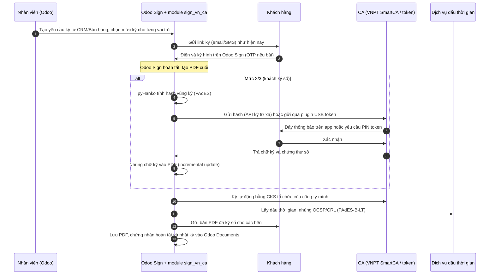

# Đề xuất: Cho Odoo Sign ký đúng pháp lý Việt Nam

> **Trạng thái:** v1, phần phương án (mục 4–7) đã được thay bằng [phương án chốt v2](phuong-an-chot-v2.md); phần pháp lý vẫn dùng · **Ngày:** 14/10/2026
> **Lưu ý:** Đây là phân tích kỹ thuật và pháp lý để định hướng, không thay cho tư vấn của luật sư. Trước khi dùng thật, nên nhờ luật sư rà lại mẫu hợp đồng và ma trận ở mục 4.

---

## 1. Tóm tắt (đọc phần này là đủ để quyết định)

1. **Không cần, và trên thực tế cũng không làm được, việc "đăng ký Odoo với Chính phủ".** Luật Việt Nam công nhận **loại chữ ký**, không công nhận **phần mềm**. Hợp đồng có giá trị pháp lý đầy đủ khi được ký bằng **chữ ký số công cộng** do một tổ chức cung cấp dịch vụ tin cậy (CA) được cấp phép phát hành, ví dụ VNPT, Viettel, FPT, MISA, BKAV. Không quan trọng chữ ký đó được tạo ra trong phần mềm nào.
2. **Nên làm theo hướng "gắn thêm chữ ký số vào Odoo Sign".** Odoo Sign vẫn lo phần quy trình: soạn, đặt vị trí ký, gửi, nhắc ký, lưu trữ, liên kết với CRM/Bán hàng. Một module tự viết sẽ nhúng **chữ ký số của CA Việt Nam** (chuẩn PAdES) vào file PDF. Như vậy anh/chị bỏ được VNeDoc/VNPT eContract riêng lẻ, mọi thứ nằm gọn trong Odoo.
3. **Chia ba mức ký, khách chọn mức phù hợp:**
   - **Mức 1, OTP:** giữ cách ký Odoo Sign như hiện nay. Phía công ty mình đóng chữ ký số tổ chức và dấu thời gian lên bản cuối.
   - **Mức 2, chữ ký số cá nhân:** khách ký bằng CKS cá nhân, qua ký từ xa trên điện thoại hoặc USB token.
   - **Mức 3, chữ ký số tổ chức:** khách ký bằng CKS của công ty họ, có giá trị như chữ ký kèm đóng dấu.
4. **Phía công ty mình luôn dùng CKS tổ chức theo mô hình ký số từ xa** (cloud/HSM), ký tự động trong Odoo, không phải cắm USB token.
5. **Đối tác CA cho giai đoạn 1: VNPT SmartCA**, vì anh/chị đang dùng VNPT và VNPT đã có tài liệu tích hợp cho đối tác. Module viết theo dạng adapter để sau này thêm Viettel MySign, FPT, MISA… mà không phải viết lại.

---

## 2. Căn cứ pháp lý

| Văn bản | Nội dung liên quan |
|---|---|
| **Luật Giao dịch điện tử 2023** (số 20/2023/QH15, hiệu lực 01/7/2024) | **Điều 22:** chia chữ ký điện tử thành 3 loại: chữ ký điện tử chuyên dùng, chữ ký số công cộng, chữ ký số chuyên dùng công vụ. **Điều 23.1:** chữ ký điện tử không bị phủ nhận giá trị pháp lý chỉ vì ở dạng điện tử. **Điều 23.2:** chữ ký điện tử chuyên dùng bảo đảm an toàn hoặc **chữ ký số** có giá trị **tương đương chữ ký tay** trên văn bản giấy. **Điều 23.3:** khi luật đòi hỏi văn bản phải có xác nhận của cơ quan, tổ chức, yêu cầu này được đáp ứng nếu văn bản được ký bằng **chữ ký số của chính tổ chức đó**. |
| **Nghị định 23/2025/NĐ-CP** (hiệu lực 10/4/2025), thay NĐ 130/2018 | Quy định về chữ ký điện tử và dịch vụ tin cậy. **Điều 26:** dịch vụ chứng thực chữ ký số công cộng có 3 mô hình: thiết bị phần cứng (USB token), **ký số từ xa**, và **trên thiết bị di động**. Nghĩa là SmartCA/MySign có giá trị pháp lý **ngang USB token**. |
| **Luật Doanh nghiệp 2020, Điều 43** | Dấu của doanh nghiệp gồm dấu khắc **hoặc dấu dưới hình thức chữ ký số**. Doanh nghiệp tự quyết định có dùng dấu hay không. |
| **Bộ luật Dân sự 2015** | **Điều 119:** giao dịch qua phương tiện điện tử dưới dạng thông điệp dữ liệu được coi là giao dịch bằng văn bản. **Điều 134–143:** chế định đại diện, quyết định *ai* có quyền ký thay công ty (người đại diện theo pháp luật hoặc người được ủy quyền). |
| **Luật Thương mại điện tử 2025** (số 122/2025/QH15, hiệu lực 01/7/2026) | Khung pháp lý cho hợp đồng điện tử và **dịch vụ chứng thực hợp đồng điện tử**, tức dịch vụ bên thứ ba lưu trữ và xác nhận tính toàn vẹn. Đơn vị đã đăng ký theo quy định cũ được hoạt động đến 30/6/2027. |
| **Luật Bảo vệ dữ liệu cá nhân** (hiệu lực 01/01/2026) | Số điện thoại, email, ảnh CCCD (nếu làm eKYC) là dữ liệu cá nhân. Cần có sự đồng ý của người ký. Nếu máy chủ Odoo đặt ở nước ngoài thì phải tính tới thủ tục chuyển dữ liệu ra nước ngoài. |

**Nguồn tra cứu:** đã đối chiếu qua các trang tổng hợp pháp luật, chưa đối chiếu Công báo gốc. Danh sách nguồn nằm ở cuối tài liệu.

---

## 3. Trả lời hai vướng mắc của anh/chị

### 3.1 "Đăng ký với Chính phủ hay gắn thêm chữ ký số?"

Có ba con đường "đăng ký", và cả ba đều **không nên chọn**:

| Con đường | Điều kiện | Kết luận |
|---|---|---|
| Trở thành **tổ chức cung cấp dịch vụ tin cậy (CA)** | Giấy phép của Bộ KH&CN, hạ tầng HSM, kiểm định, ký quỹ, nhân sự chuyên trách | Không khả thi với quy mô hiện tại và cũng không cần |
| Đăng ký **chữ ký điện tử chuyên dùng bảo đảm an toàn** | Theo luật, loại này chỉ dùng **riêng cho hoạt động nội bộ của tổ chức**, và phải được chứng nhận | Không phù hợp để ký với khách hàng bên ngoài |
| Đăng ký **dịch vụ chứng thực hợp đồng điện tử** (Luật TMĐT 2025) | Chỉ bắt buộc khi anh/chị **cung cấp dịch vụ cho bên thứ ba** | Không cần nếu chỉ ký hợp đồng của chính công ty mình (xem lưu ý bên dưới) |

➡️ **Lối đi đúng là gắn chữ ký số của một CA đã được cấp phép vào Odoo Sign.** Phần mềm không cần giấy phép, vì giá trị pháp lý nằm ở chứng thư số.

> ⚠️ **Lưu ý về phạm vi:** Nếu sau này anh/chị muốn **cho các phòng khám dùng hệ thống này để họ ký với bệnh nhân hoặc đối tác của họ**, lúc đó anh/chị đang cung cấp dịch vụ hợp đồng điện tử cho bên thứ ba. Khi ấy cần xem lại nghĩa vụ đăng ký theo Luật TMĐT 2025 và nghị định hướng dẫn.

### 3.2 "Cá nhân ký bằng OTP thì là ký cho công ty hay cho cá nhân?"

Câu hỏi này gộp hai vấn đề khác nhau, cần tách ra:

**(a) Ai là bên của hợp đồng và người ký có thẩm quyền không?** Điều này do luật dân sự và luật doanh nghiệp quyết định, **không phụ thuộc vào công nghệ ký**.
- Nếu hợp đồng ghi *"Bên B: Công ty TNHH X, đại diện bởi ông/bà A, chức vụ Giám đốc"*, và ông/bà A đúng là người đại diện theo pháp luật hoặc người được ủy quyền, thì khi A ký, **hợp đồng ràng buộc Công ty X**. Điều này đúng kể cả khi A dùng phương tiện ký cá nhân.
- Dấu **không bắt buộc**, trừ khi điều lệ công ty, luật chuyên ngành hoặc đối tác yêu cầu.
- Nếu phòng khám là **hộ kinh doanh hoặc phòng khám tư nhân đứng tên một bác sĩ**, thì chữ ký cá nhân của chủ phòng khám chính là chữ ký của bên hợp đồng.

**(b) Chữ ký đó mạnh đến đâu về mặt chứng cứ?** Phần này phụ thuộc vào công nghệ ký.
- OTP qua SMS hoặc email vẫn là chữ ký điện tử **có giá trị** (Điều 23.1). Tuy nhiên nó **không phải chữ ký số**, nên **không mặc nhiên ngang chữ ký tay** (Điều 23.2). Khi có tranh chấp, anh/chị phải tự chứng minh bằng nhật ký ký (log, IP, thời gian, số điện thoại nhận OTP).
- OTP cũng **không thay được dấu của tổ chức** (Điều 23.3). Vì vậy hồ sơ nộp cho thuế, ngân hàng, bảo hiểm, đấu thầu hay thanh tra thường **bị từ chối** nếu chỉ ký bằng OTP. Đây chính là lý do một số khách đòi ký bằng CKS công ty.

**Kết luận thực tế:**

| Nhu cầu của khách | Mức ký nên dùng |
|---|---|
| Hợp đồng dịch vụ thông thường, khách là cá nhân hoặc chủ phòng khám, chỉ cần hợp đồng có hiệu lực | **Mức 1 (OTP)** + điều khoản thỏa thuận giao kết điện tử (mục 4.3) |
| Khách muốn chữ ký có giá trị như chữ ký tay, giá trị hợp đồng lớn | **Mức 2 (CKS cá nhân)** |
| Khách cần hồ sơ có "dấu công ty" để làm thủ tục hành chính, thuế, quyết toán | **Mức 3 (CKS tổ chức)** |

> 💡 **Phương án trung gian:** nhiều CA có gói **chứng thư số cá nhân thuộc tổ chức**, trong chứng thư ghi cả tên người ký lẫn tên công ty. Gói này phù hợp khi giám đốc phòng khám muốn tự ký trên điện thoại mà vẫn thể hiện tư cách công ty. Cần hỏi CA cụ thể về loại chứng thư này.

---

## 4. Phương án đề xuất

### 4.1 Ma trận mức ký

| | Mức 1: OTP | Mức 2: CKS cá nhân | Mức 3: CKS tổ chức |
|---|---|---|---|
| Cách khách ký | Như Odoo Sign hiện nay (vẽ hoặc gõ chữ ký, OTP SMS/email) | Vẽ chữ ký trên Odoo, rồi xác nhận bằng **SmartCA trên điện thoại** hoặc **USB token** | Như Mức 2, dùng chứng thư của công ty khách |
| Phía công ty mình | CKS tổ chức + dấu thời gian | CKS tổ chức + dấu thời gian | CKS tổ chức + dấu thời gian |
| Giá trị chữ ký của khách | Có hiệu lực; khi tranh chấp phải chứng minh | **Tương đương chữ ký tay** (Điều 23.2) | **Tương đương chữ ký kèm dấu** (Điều 23.3) |
| Chi phí phía khách | 0 | Khách cần có CKS cá nhân | Khách cần có CKS tổ chức (đa số doanh nghiệp đã có để khai thuế) |
| Ma sát | Thấp nhất | Trung bình | Trung bình |

Riêng ở **Mức 1**, việc công ty mình đóng CKS và dấu thời gian lên bản cuối giúp **khóa toàn vẹn tài liệu**. Sau thời điểm đó, nếu ai sửa dù chỉ một ký tự, chữ ký số sẽ báo không hợp lệ. Điều này làm chứng cứ OTP của khách mạnh hơn đáng kể.

### 4.2 Luồng ký kỹ thuật

**Các điểm kỹ thuật chính:**
- **Không sửa lõi Odoo Sign.** Module kế thừa (`_inherit`) `sign.request` và `sign.item.role`, rồi thêm một **giai đoạn ký số** sau khi Odoo Sign đã ghép xong PDF cuối. Trạng thái mới là "Chờ ký số", rồi "Đã ký số". Cách làm này an toàn khi nâng cấp phiên bản Odoo.
- **Mỗi chữ ký là một incremental update** của PDF, nên nhiều chữ ký nối tiếp không làm hỏng nhau. Thư viện dùng là **pyHanko** (mã nguồn mở, có sẵn chế độ *interrupted signing* cho ký từ xa).
- **Ký từ xa:** Odoo chỉ gửi **hash**, không gửi nội dung hợp đồng sang CA. Khách bấm xác nhận trên app điện thoại.
- **USB token:** trình duyệt không truy cập được token trực tiếp. Cần một **phần mềm ký chạy trên máy khách** (signing agent trên localhost): hoặc dùng plugin sẵn có của từng CA, hoặc tự viết một agent PKCS#11 dùng chung cho nhiều loại token. Đây là phần tốn công nhất, nên để **giai đoạn 2**.
- **Adapter theo nhà cung cấp:** `provider = vnpt_smartca | viettel_mysign | fpt | misa | usb_agent`. Thêm CA mới chỉ cần viết thêm một class.
- **Kiểm tra chữ ký:** mở PDF bằng Adobe hoặc Foxit (cần cài Root CA quốc gia, vì Adobe không tin cậy mặc định) hoặc dùng công cụ kiểm tra chữ ký số của cơ quan quản lý. Có thể thêm nút "Kiểm tra chữ ký" ngay trong Odoo.

### 4.3 Bổ sung vào mẫu hợp đồng (áp dụng cho mọi mức)

Thêm điều khoản *thỏa thuận về giao kết điện tử* để củng cố Mức 1. Gợi ý nội dung, cần luật sư hoàn thiện:

> Các Bên thống nhất giao kết Hợp đồng này bằng phương tiện điện tử trên hệ thống [tên hệ thống] của Bên A. Các Bên thừa nhận việc xác thực bằng mã OTP gửi tới số điện thoại/email đã đăng ký [và/hoặc chữ ký số] là phương thức xác định người ký và thể hiện sự chấp thuận nội dung Hợp đồng. Bản Hợp đồng điện tử được Bên A ký số và gắn dấu thời gian là bản gốc có giá trị pháp lý ràng buộc các Bên.

Ngoài ra, phần thông tin các bên nên ghi rõ **người đại diện, chức vụ và căn cứ đại diện** (điều lệ hoặc giấy ủy quyền). Đây là điểm quyết định hợp đồng có ràng buộc công ty hay không (mục 3.2a).

---

## 5. Lộ trình triển khai

| Giai đoạn | Nội dung | Ước lượng công dev* |
|---|---|---|
| **0. Chuẩn bị** (song song) | Ký hợp đồng đối tác tích hợp với VNPT SmartCA (lấy client_id/secret và môi trường sandbox). Mua **chứng thư số tổ chức loại ký từ xa** cho công ty. Luật sư rà mẫu hợp đồng. | 1–2 tuần (chủ yếu chờ thủ tục) |
| **1. MVP** | Module `sign_vn_ca`: CKS tổ chức của mình ký tự động + dấu thời gian + PAdES-B-LT cho **mọi** hợp đồng (Mức 1); khách ký **SmartCA** (Mức 2/3); trạng thái và nhật ký trong Odoo; nút kiểm tra chữ ký. | 4–6 tuần |
| **2. USB token** | Signing agent cho máy Windows của khách (PKCS#11, hỗ trợ các token phổ biến), hoặc tích hợp plugin của các CA chính. | 3–4 tuần |
| **3. Mở rộng** | Thêm CA khác (Viettel, FPT, MISA…); eKYC CCCD/VNeID cho Mức 1; tùy chọn gửi bản cuối lên dịch vụ chứng thực hợp đồng điện tử; báo cáo chứng thư sắp hết hạn. | Theo nhu cầu |

\* Ước lượng thô cho một lập trình viên Odoo có kinh nghiệm. Số chính xác sẽ có sau khi đọc tài liệu API thật của CA.

**Chi phí vận hành cần xin báo giá:** thuê bao chứng thư số tổ chức từ xa (theo năm), phí API hoặc lượt ký (theo gói), dịch vụ dấu thời gian. Nên so sánh với chi phí VNeDoc/VNPT eContract đang trả để xem điểm hòa vốn.

---

## 6. Rủi ro và cách xử lý

| Rủi ro | Xử lý |
|---|---|
| Odoo Online (SaaS) **không cho cài module Python tự viết** | Cần chạy trên **Odoo.sh hoặc máy chủ riêng**. Nếu đang dùng Odoo Online thì phải chuyển. |
| API của các CA khác nhau và thay đổi theo thời gian | Thiết kế adapter, viết test với sandbox của CA, theo dõi phiên bản API |
| Khách không có CKS cá nhân hoặc tổ chức | Mặc định dùng Mức 1. Có thể giới thiệu khách mua SmartCA (vài phút eKYC trên app) |
| Adobe báo "chữ ký chưa xác minh" vì không tin cậy Root CA Việt Nam | Gửi kèm hướng dẫn cài Root CA, hoặc dùng công cụ kiểm tra của cơ quan quản lý hay nút kiểm tra trong Odoo |
| Dữ liệu cá nhân (SĐT, CCCD) nằm trên máy chủ ở nước ngoài | Thu thập sự đồng ý trong luồng ký, cân nhắc đặt máy chủ tại Việt Nam, lập hồ sơ đánh giá tác động theo Luật BVDLCN |
| Giao dịch mà luật chuyên ngành yêu cầu công chứng hoặc hình thức riêng | Không đưa vào luồng này. Hợp đồng dịch vụ B2B với phòng khám không thuộc nhóm này. |
| Lưu trữ dài hạn (chứng thư hết hạn sau vài năm) | PAdES-B-LT, tức nhúng sẵn OCSP/CRL và dấu thời gian, để vẫn kiểm chứng được sau khi chứng thư hết hạn. Có thể bổ sung B-LTA sau. |

---

## 7. Cần anh/chị duyệt

- [ ] **Hướng đi:** gắn chữ ký số của CA được cấp phép vào Odoo Sign; không tự đăng ký làm CA hay làm chữ ký chuyên dùng.
- [ ] **Phạm vi:** chỉ ký hợp đồng của chính công ty mình. Chưa cung cấp dịch vụ ký cho phòng khám dùng với bên thứ ba.
- [ ] **Ma trận 3 mức ký** (mục 4.1). Mặc định Mức 1; khách yêu cầu thì nâng lên Mức 2/3.
- [ ] **CA giai đoạn 1:** VNPT SmartCA.
- [ ] **Lộ trình:** Giai đoạn 0 và 1 trước, USB token ở giai đoạn 2.
- [ ] **Cung cấp thông tin:** phiên bản Odoo đang dùng (17/18/19?) và nơi chạy (Odoo Online / Odoo.sh / máy chủ riêng).

Sau khi được duyệt, bước tiếp theo là dựng khung module `sign_vn_ca` trong repo này, viết phần ký tự động bằng CKS tổ chức trước, dùng chứng thư test, rồi nối API SmartCA khi có tài khoản sandbox.

---

## Nguồn tham khảo

- Luật Giao dịch điện tử 2023 (số 20/2023/QH15), toàn văn: [binhphuoc.gov.vn (PDF)](https://binhphuoc.gov.vn/uploads/binhphuoc/news/2024_04/luat20-2023-qh15.pdf) · [caselaw.vn](https://caselaw.vn/van-ban-phap-luat/411469-luat-giao-dich-dien-tu-so-20-2023-qh15-ngay-22-06-2023-cua-quoc-hoi) · [lsvn.vn: giá trị pháp lý của chữ ký điện tử](https://lsvn.vn/gia-tri-phap-ly-cua-chu-ky-dien-tu-duoc-quy-dinh-the-nao-1697702148-a136561.html)
- Nghị định 23/2025/NĐ-CP: [caselaw.vn](https://caselaw.vn/van-ban-phap-luat/411540-nghi-dinh-so-23-2025-nd-cp-ngay-21-02-2025-cua-chinh-phu-quy-dinh-ve-chu-ky-dien-tu-va-dich-vu-tin-cay) · [Điều 26](https://hethongphapluat.com/nghi-dinh-23-2025-nd-cp-quy-dinh-ve-chu-ky-dien-tu-va-dich-vu-tin-cay/dieu-26) · [luatvietan.vn](https://luatvietan.vn/chu-ky-dien-tu-va-dich-vu-tin-cay-theo-nghi-dinh-23-2025.html)
- Luật Doanh nghiệp 2020, Điều 43 về con dấu: [thuvienphapluat.vn](https://thuvienphapluat.vn/phap-luat/giam-doc-co-duoc-mang-theo-con-dau-cong-ty-ra-khoi-cong-ty-khong-chu-ky-so-co-duoc-xem-la-con-dau-c-18185.html)
- Luật Thương mại điện tử 2025 (số 122/2025/QH15): [thuvienphapluat.vn](https://thuvienphapluat.vn/phap-luat-nha-dat/toan-van-luat-thuong-mai-dien-tu-2025-luat-so-1222025qh15-moi-nhat-ra-sao-13968.html) · [luatvietnam.vn](https://luatvietnam.vn/bai-viet-lien-quan/luat-122-2025-qh15-423356.html)
- Thảo luận OTP/SMS có phải chữ ký điện tử: [vneconomy.vn](https://vneconomy.vn/du-thao-luat-giao-dich-dien-tu-cac-hinh-thuc-otp-sms-hay-sinh-trac-hoc-co-phai-la-chu-ky-dien-tu.htm)
- Tài liệu tích hợp VNPT SmartCA cho đối tác: [doitac-smartca.vnpt.vn](https://doitac-smartca.vnpt.vn/help/document/TL_tich_hop_ban_hang_SmartCA_v1.0.pdf)
- pyHanko, ký PDF chuẩn PAdES và ký từ xa: [pyhanko.readthedocs.io](https://pyhanko.readthedocs.io/en/0.17.0/api-docs/pyhanko.sign.signers.pdf_cms.html) · [PyPI](https://pypi.org/project/pyHanko/0.17.0/)
