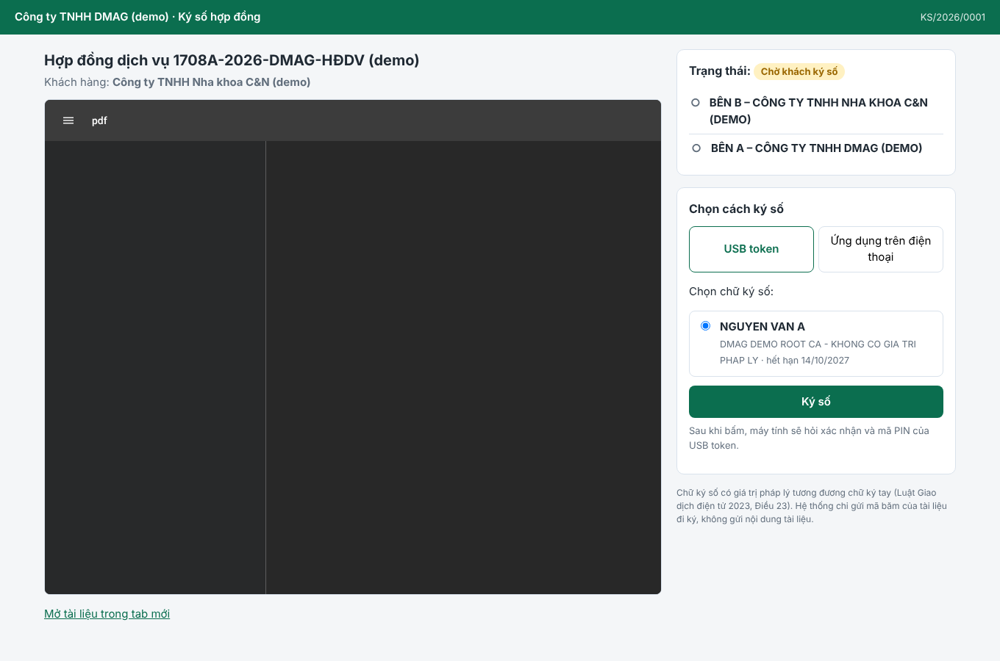
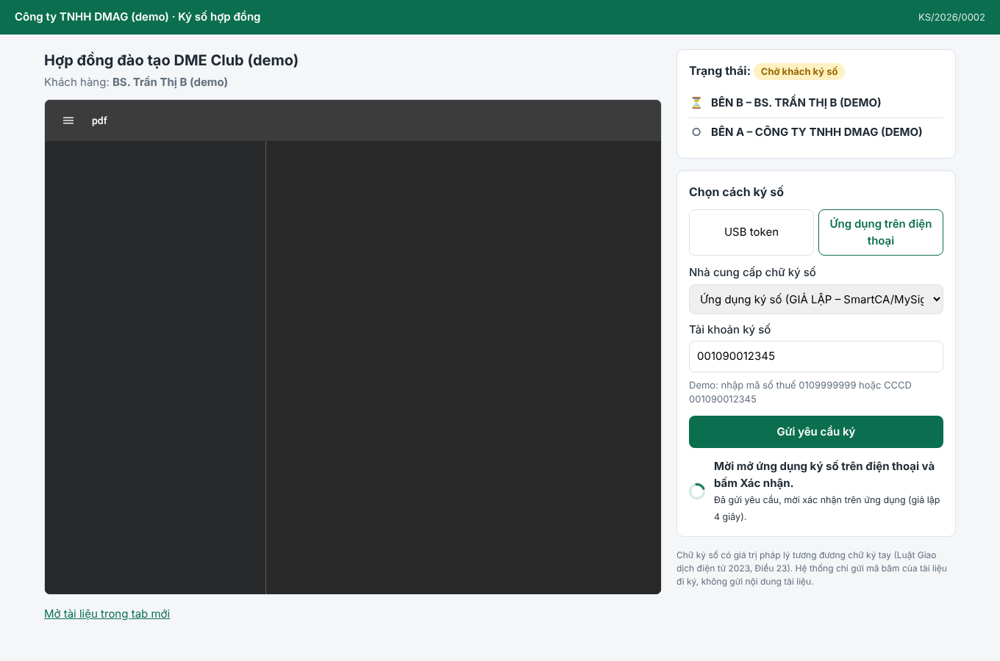
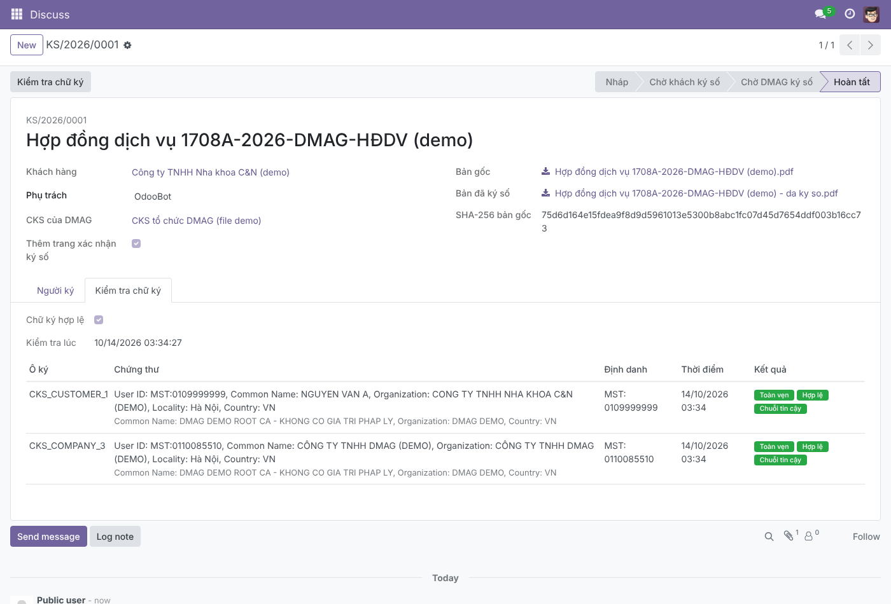
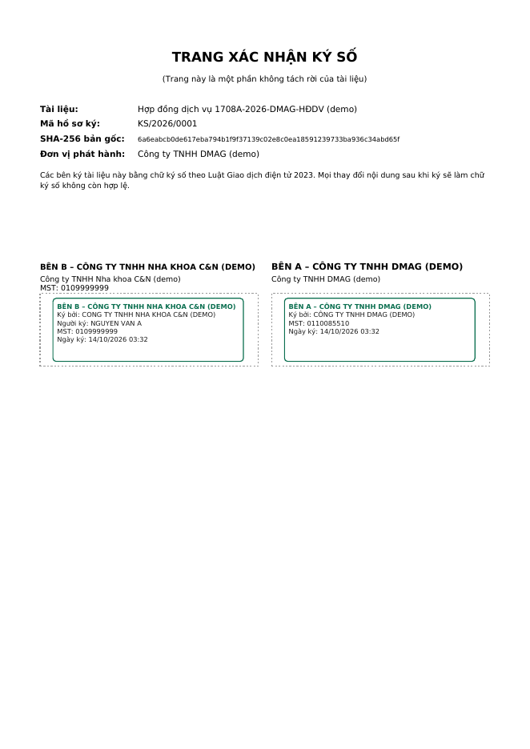
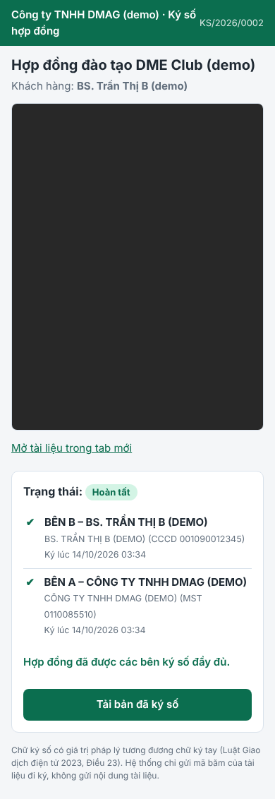

# Hướng dẫn triển khai addon ký số `dmag_esign_cks` (Odoo 17)

> Gửi kèm cho Bizapps khi cài đặt. Phương án nghiệp vụ xem ở [phuong-an-chot-v2.md](phuong-an-chot-v2.md).

## 1. Addon làm gì

Addon chỉ **gắn thêm chữ ký số** vào tài liệu, **không sửa** module ký của Bizapps.

| Ai ký | Cách ký | Trạng thái |
|---|---|---|
| Nội bộ | Module ký sẵn có của Bizapps | Không đổi |
| Khách hàng không cần CKS | Ký trên module ký của Bizapps như hiện nay (vẽ chữ ký / OTP) | Không đổi. DMAG đóng CKS tổ chức lên bản cuối. |
| Khách có **USB token** (mọi nhà cung cấp) | Trang ký → "USB token" → chọn chứng thư → nhập PIN | ✅ Đã làm |
| Khách có **CKS ký từ xa** | Trang ký → "Ứng dụng trên điện thoại" → nhập tài khoản → xác nhận trên app | ✅ Khung xong, adapter VNPT SmartCA và Viettel MySign chờ tài khoản sandbox để đối chiếu |
| **DMAG** | Tự động ký CKS tổ chức sau khi khách ký xong (kèm dấu thời gian nếu có TSA) | ✅ Đã làm (file .p12). Ký từ xa chờ tài khoản |

Sau khi các bên ký xong:
- File PDF có các chữ ký số chuẩn **PAdES**, mở bằng Adobe/Foxit là thấy.
- Có thêm **trang xác nhận ký số** ghi mã SHA-256 của bản gốc.
- Odoo **tự kiểm tra** từng chữ ký: còn toàn vẹn, hợp lệ, chuỗi về Root CA tin cậy, và **MST/CCCD trong chứng thư khớp với khách hàng**.

Ảnh chụp từ lần chạy thử đầu-cuối:

| Khách chọn USB token | Khách ký bằng app | Quản trị: kết quả kiểm tra |
|---|---|---|
|  |  |  |

| Trang xác nhận ký số trong PDF | Trên điện thoại |
|---|---|
|  |  |

## 2. Cài đặt trên máy chủ Odoo 17

1. Cài thư viện Python (đã thử trên image chính thức `odoo:17.0`):
   ```bash
   pip3 install -r requirements.txt
   # pyHanko==0.25.3, pyOpenSSL==24.2.1, urllib3==1.26.20
   ```
   pyHanko cần `cryptography` bản mới. Vì vậy phải nâng `pyOpenSSL` và `urllib3` cùng lúc, nếu không Odoo
   sẽ lỗi khi import `ir_mail_server`. Bộ phiên bản trên đã chạy được với Odoo 17.
2. Chép thư mục `addons/dmag_esign_cks` vào addons path, cập nhật danh sách ứng dụng, cài **"DMAG – Chữ ký số cho hợp đồng"**.
   Addon chỉ phụ thuộc `mail` và `portal`.
3. Chạy test: `odoo -d <db_test> -i dmag_esign_cks --test-enable --test-tags=/dmag_esign_cks --stop-after-init`
   (kết quả lúc phát triển: **14/14 test đạt**).

Chạy thử nhanh bằng Docker: `docker compose up -d` rồi mở http://localhost:8069 (admin/admin, DB có dữ liệu demo).

## 3. Cấu hình (menu **Ký số › Cấu hình**)

1. **Nhà cung cấp chữ ký số**
   - **CKS của DMAG:** tạo bản ghi, đánh dấu "Dùng để DMAG ký".
     - Loại *Chứng thư trên máy chủ (.p12/.pfx)*: tải file lên và nhập mật khẩu.
     - Loại *VNPT SmartCA / Viettel MySign*: nhập API, Client ID/secret và "Tài khoản ký của DMAG".
     - Có thể nhập *TSA URL* để gắn dấu thời gian.
   - **Cho khách ký từ xa:** bản ghi *VNPT SmartCA* và *Viettel MySign* đã tạo sẵn ở trạng thái lưu trữ. Điền thông tin tài khoản đối tác rồi bật lên.
     Nếu tài liệu API của nhà cung cấp khác mặc định, sửa ở ô *Endpoint tùy chỉnh (JSON)*, không cần sửa code.
   - Bấm **Kiểm tra kết nối / chứng thư** để thử.
2. **Root CA tin cậy:** thêm Root CA quốc gia và CA gốc của các nhà cung cấp (VNPT, Viettel, BKAV, FPT, MISA…).
   Thiếu Root CA thì cột "Chuỗi tin cậy" sẽ báo đỏ dù chữ ký vẫn toàn vẹn.
3. **Khách hàng:** ô *Mã số thuế* có sẵn. Addon thêm **Số CCCD (ký số)** cho cá nhân và **Luôn yêu cầu ký số**.

## 4. Phần mềm "DMAG Ký số" cho USB token

- Mã nguồn ở `agent/` (Go), build bằng `agent/build.sh`. Script tạo `DMAGKySo.exe` và tự chép vào addon,
  để trang ký có link tải.
- Khách **tải về, bấm đúp một lần**: phần mềm tự cài cho người dùng hiện tại (không cần quyền admin) và tự chạy khi bật máy.
- Phần mềm đọc kho chứng thư Windows, nên **dùng được token của mọi nhà cung cấp**, vì driver token khách đã cài để khai thuế đưa chứng thư vào đó.
- **Bảo mật:**
  - Phần mềm chỉ nghe trên `127.0.0.1`.
  - Chỉ trang trong danh sách cho phép mới gọi được. Mặc định gồm `dmagroup.vn` và `localhost:8069`. Gặp tên miền lạ, phần mềm hỏi người dùng.
  - Trước mỗi lần ký, phần mềm hiện hộp thoại xác nhận, sau đó driver token hỏi PIN.
  - Phần mềm chỉ nhận **mã băm**, không nhận nội dung hợp đồng.
- Nếu Odoo chạy ở tên miền khác (ví dụ `erp.dmagroup.vn`), build lại với `ORIGINS=https://erp.dmagroup.vn ./build.sh`, hoặc để khách bấm "Có" lần đầu.
- **Trước khi phát hành:** nên ký số file .exe (Authenticode) để Windows SmartScreen và phần mềm diệt virus không cảnh báo.

## 5. Nối với module ký của Bizapps (việc còn lại cho Bizapps)

Addon cung cấp mixin `dmag.cks.mixin`. Bizapps chỉ cần một module cầu nối nhỏ. Các chỗ `<...>` thay bằng tên thật trong module của Bizapps:

```python
from odoo import models


class BizappsSignRequest(models.Model):
    _name = '<model yêu cầu ký của Bizapps>'
    _inherit = ['<model yêu cầu ký của Bizapps>', 'dmag.cks.mixin']

    def <hàm chạy khi tất cả đã ký xong>(self):
        res = super().<hàm chạy khi tất cả đã ký xong>()
        for request in self:
            pdf = <bytes PDF đã ký của request>
            partner = <khách hàng của request>
            # Mặc định: khách đã ký trên Odoo, DMAG chỉ đóng CKS tổ chức.
            # Khách "Luôn yêu cầu ký số": gửi thêm link ký bằng USB token / app.
            request._dmag_cks_send(pdf, request.display_name, partner,
                                   require_customer=partner.dmag_cks_require)
        return res

    def _dmag_cks_on_done(self, envelope):
        # Nhận bản PDF đã ký số đầy đủ, ví dụ gắn vào request hoặc vào hợp đồng.
        self.write({'<trường file đã ký>': envelope.signed_pdf})
```

- Cách nối tương tự áp dụng cho hợp đồng DMAG (`dmag.contract`): trong `_dmag_cks_on_done`, chuyển hợp đồng sang "Đã ký" và gắn file PDF đã ký.
- Chưa có module ký của Bizapps thì vẫn dùng được ngay: menu **Ký số › Gửi PDF đi ký số** (tải PDF lên, chọn khách, gửi). Wizard này cũng nhận tệp đính kèm của bất kỳ bản ghi nào.

## 6. Đã kiểm chứng và chưa kiểm chứng

| Hạng mục | Kết quả |
|---|---|
| Ký PAdES nhiều chữ ký nối tiếp (RSA, ECDSA), chữ ký sai bị từ chối, sửa 1 byte thì mọi chữ ký báo hỏng | ✅ Test tự động |
| Luồng Odoo: khách ký USB, sai MST bị chặn, cá nhân ký vào ô tổ chức bị chặn, ký từ xa (giả lập) có chờ xác nhận, DMAG tự ký, chỉ DMAG ký | ✅ 14/14 test Odoo |
| Trình duyệt thật: trang ký, phần mềm ký (bản Linux, chứng thư PEM thay token), ký từ xa giả lập | ✅ Playwright + Chromium |
| PDF kiểm tra bằng công cụ độc lập (poppler `pdfsig`) | ✅ "Signature is Valid" |
| **Phần mềm DMAG Ký số trên Windows với USB token thật** | ⏳ Code đã biên dịch, **chưa chạy trên máy Windows**. Danh sách kiểm thử ở `agent/README.md` |
| **API VNPT SmartCA / Viettel MySign thật** | ⏳ Code theo tài liệu công khai, **cần tài khoản sandbox để đối chiếu** endpoint và tên trường |
| Dấu thời gian (TSA) của CA thật, kiểm tra thu hồi (OCSP/CRL) trực tuyến | ⏳ Có trong code, chưa thử với dịch vụ thật |
| Mở PDF trong Adobe Reader trên Windows | ⏳ Cần cài Root CA Việt Nam vào Adobe để hiện "hợp lệ" |
