# Hướng dẫn triển khai addon ký số `dmag_esign_cks` (Odoo 17)

> Gửi kèm cho Bizapps khi cài đặt. Phương án nghiệp vụ xem ở [phuong-an-chot-v2.md](phuong-an-chot-v2.md).

## 0. Cách dùng chính: ký số ngay trong hộp chọn chữ ký của module Sign (module `dmag_esign_cks_sign`)

> Hướng dẫn cài cho Bizapps ở file riêng: [cai-dat-cho-bizapps.md](cai-dat-cho-bizapps.md). Gói cài tạo bằng `./package.sh`.

Người ký mở link ký của module Sign như bình thường và bấm vào ô chữ ký. Hộp chọn chữ ký có thêm:
- **lời nhắc màu vàng:** nên ký bằng chữ ký số để hợp đồng được công nhận khi làm thủ tục hành chính;
- **tab "USB token"** (mở sẵn): chọn chứng thư trên máy qua phần mềm DMAG Ký số, nhập PIN;
- **tab "App ký số"**: Viettel MySign, VNPT SmartCA… Người ký nhập tài khoản, bấm "Kiểm tra" để xem chứng thư, khi hoàn tất thì xác nhận trên điện thoại.

Các cách vẽ, gõ tên và tải ảnh vẫn dùng được.

| Khách ký USB token | Đang ký số | DMAG ký bằng Viettel MySign | Chờ xác nhận trên app |
|---|---|---|---|
| 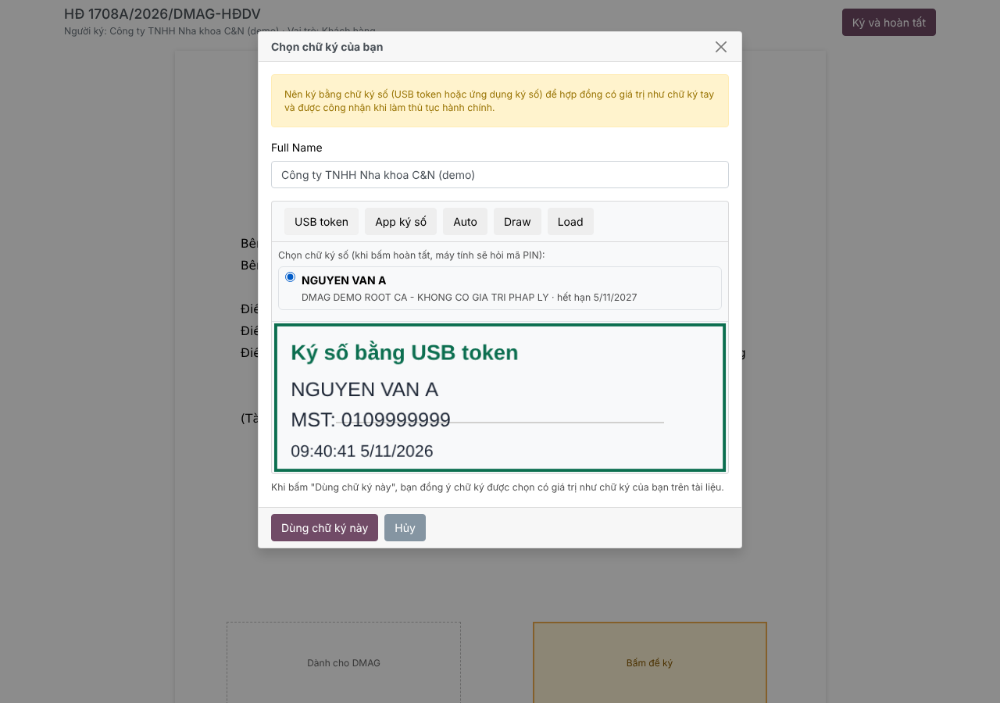 | 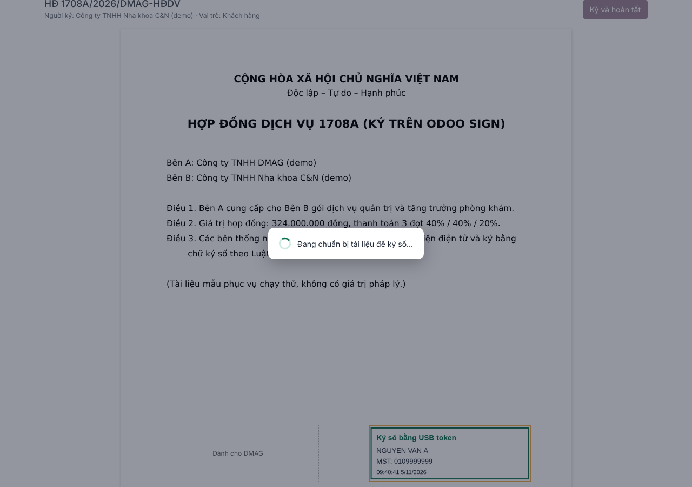 | 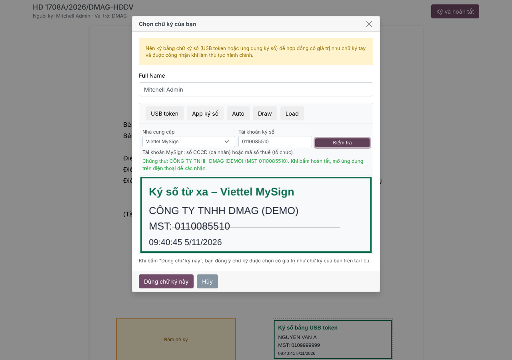 | 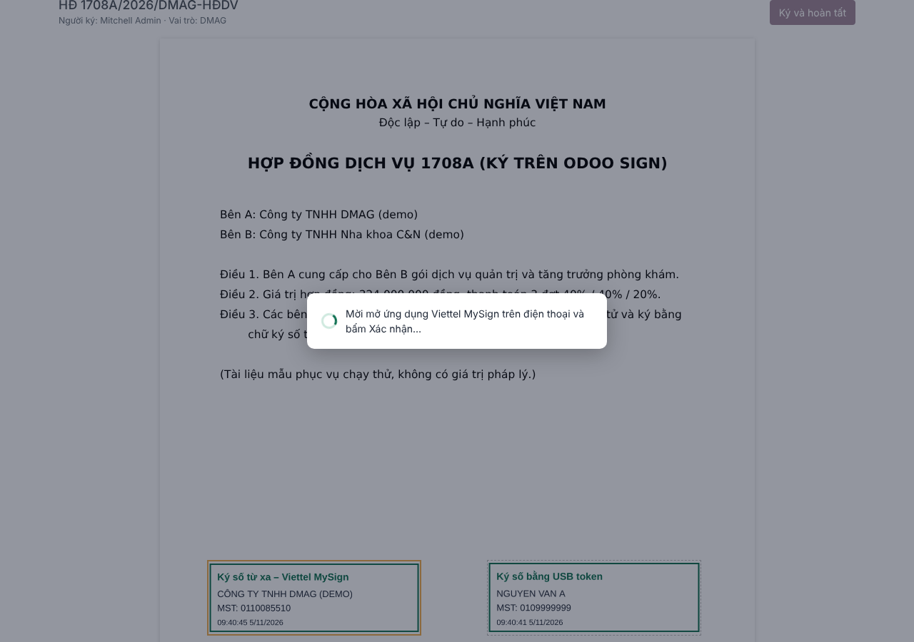 |

| Cấu hình: kiểm tra 29/29 khớp | Module dò (chỉ đọc) | Tài liệu: Ký số 2/2 bên | Bản hoàn tất |
|---|---|---|---|
| 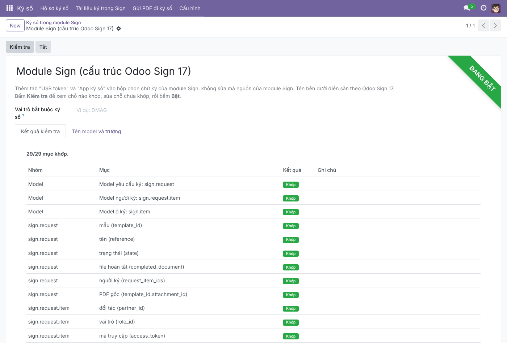 | 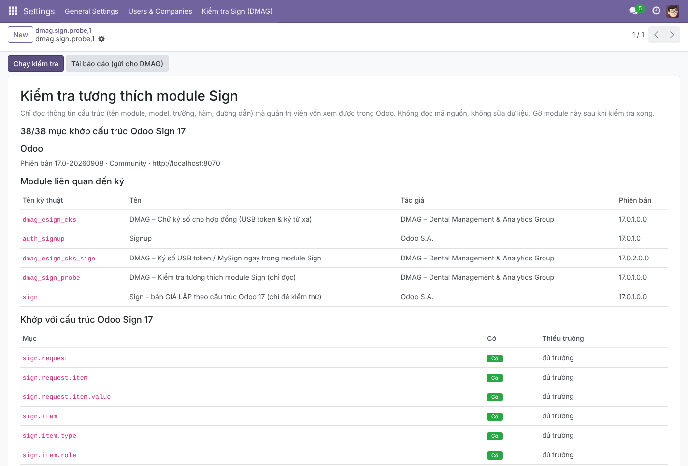 | 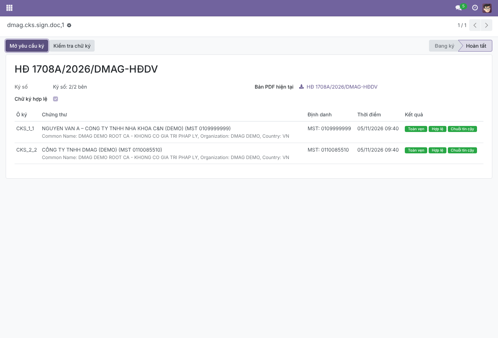 | 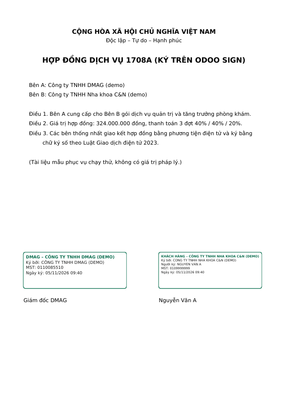 |

**Không cần mã nguồn module Sign:**
- Addon **không phụ thuộc tên module Sign** và không sửa file nào của module đó.
- **Tên model, trường, hàm, đường dẫn** nằm trong cấu hình (*Ký số › Cấu hình › Ký số trong module Sign*), điền sẵn theo Odoo Sign 17. Nút **Kiểm tra** cho biết chỗ nào khớp.
- **Khi bấm Bật**, addon gắn thêm bước ký số vào hàm "người ký ký xong" và hàm "tạo file hoàn tất" của module Sign lúc Odoo khởi động. Đây là cách module Tự động hóa của Odoo vẫn dùng. Bấm **Tắt** là gỡ ngay.
- **Trên trang ký:** lúc trang gửi chữ ký lên máy chủ (đường dẫn trong cấu hình), addon ký số trước rồi mới cho yêu cầu đi tiếp. Module Sign vẫn tự xử lý và hiển thị như bình thường. Ký số lỗi (hủy PIN, từ chối trên app…) thì module Sign hiện thông báo lỗi của chính nó.
- **Không khớp** (trang ký khác, hộp ký không dùng component chuẩn của Odoo): các tab không hiện, Sign chạy như cũ.
- **Module dò `dmag_sign_probe`** (chỉ đọc) tạo báo cáo xanh/đỏ và file JSON để gửi DMAG, không cần xem mã nguồn.

**Cách hoạt động:**
- **Thứ tự ký theo module Sign.** Ai ký trước cũng được, hoặc ký lần lượt nếu mẫu có cài thứ tự.
- **Hai người ký cùng lúc:** người đến sau được tự ký lại trên bản mới nhất. Nếu cả hai đã ký xong trên thiết bị, người gửi sau nhận thông báo "vui lòng bấm ký lại".
- **Người ký thường** (vẽ, gõ, tải ảnh) sau khi đã có chữ ký số: phần của họ được ghi thêm thành lớp chú thích có tên `DMAG-CKS-…`, không làm hỏng chữ ký số trước. Chú thích lạ hoặc sửa nội dung trang vẫn bị báo hỏng (có test).
- **Khi mọi bên ký xong:** file hoàn tất là bản đã chốt, Sign không vẽ lại. Odoo tự kiểm tra chữ ký. Menu *Ký số › Tài liệu ký trong Sign* hiện "Ký số: x/y bên".
- **Chặn sai người ký:**
  - Chứng thư có MST phải khớp MST của khách.
  - Nhân viên nội bộ phải dùng chứng thư mang MST của chính công ty, kể cả khi ký bằng USB token hay MySign.
  - Chứng thư cá nhân phải khớp số CCCD trong hồ sơ, nếu hồ sơ có số CCCD.
- **Vai trò bắt buộc ký số:** khai trong cấu hình. Khi đó hộp ký chỉ còn tab USB token và App ký số, và máy chủ từ chối nếu người ở vai trò đó ký bằng cách khác.

**Viettel MySign:**
- Adapter viết theo tài liệu "MySign API" v1.8 của Viettel-CA, đối chiếu với SDK cộng đồng ViettelConnect:
  - Các đường dẫn `/vtss/service/ras/v1/login`, `certificates/info`, `signHash`, `requests/status`.
  - Tên tài liệu gửi đi được bỏ dấu và mã hóa base64.
  - Mã `async=2`.
  - Mã trạng thái: `1` là xong, `4001` là hết hạn, `4002` là từ chối.
- Đã test với máy chủ MySign giả lập cùng giao thức.
- **Chưa test với tài khoản thật:** cần tài khoản *đối tác tích hợp API* (Client ID, Client secret, Profile ID) do Viettel-CA cấp. Tài khoản MySign cá nhân của Giám đốc chỉ là tài khoản để ký, không dùng thay cho tài khoản đối tác được.

---

## 1. Addon làm gì

Addon chỉ **gắn thêm chữ ký số** vào tài liệu, **không sửa** module ký của Bizapps.

| Ai ký | Cách ký | Trạng thái |
|---|---|---|
| Nội bộ | Module ký sẵn có của Bizapps | Không đổi |
| Khách hàng không cần CKS | Ký trên module ký của Bizapps như hiện nay (vẽ chữ ký / OTP) | Không đổi. DMAG đóng CKS tổ chức lên bản cuối. |
| Khách có **USB token** (mọi nhà cung cấp) | Trang ký → "USB token" → chọn chứng thư → nhập PIN | ✅ Đã làm |
| Khách có **CKS ký từ xa** | Trang ký → "Ứng dụng trên điện thoại" → nhập tài khoản → xác nhận trên app | ✅ Khung xong, adapter VNPT SmartCA và Viettel MySign chờ tài khoản sandbox để đối chiếu |
| **DMAG** | **Mặc định: người của DMAG ký bằng USB token chứng thư tổ chức** (bấm "DMAG ký bằng USB token" trên hồ sơ). Odoo chặn nếu token không đúng MST của DMAG. Tùy chọn: ký tự động bằng file .p12 hoặc ký từ xa | ✅ USB token và .p12 đã làm. Ký từ xa chờ tài khoản |

Sau khi các bên ký xong:
- File PDF có các chữ ký số chuẩn **PAdES**, mở bằng Adobe/Foxit là thấy.
- Có thêm **trang xác nhận ký số** ghi mã SHA-256 của bản gốc.
- Odoo **tự kiểm tra** từng chữ ký: còn toàn vẹn, hợp lệ, chuỗi về Root CA tin cậy, và **MST/CCCD trong chứng thư khớp với khách hàng**.

Ảnh chụp từ lần chạy thử đầu-cuối (hai bên đều ký bằng USB token):

| 1. Khách chọn USB token | 2. Khách ký xong, chờ DMAG | 3. Quản trị: đến lượt DMAG |
|---|---|---|
| 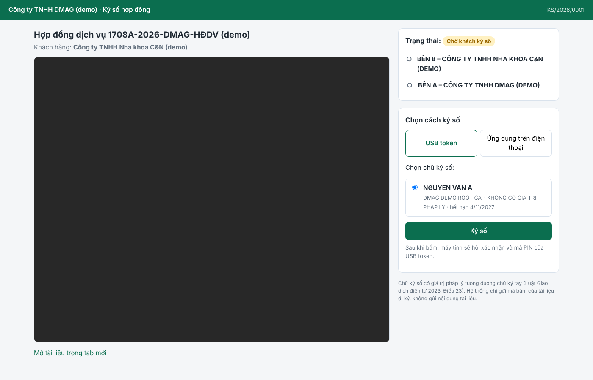 | 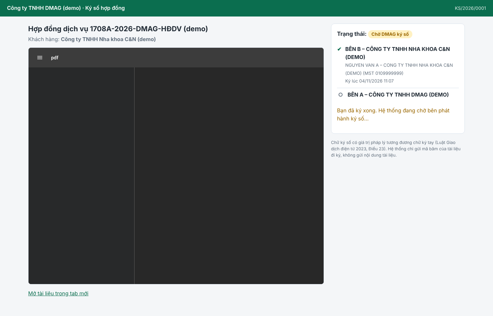 | 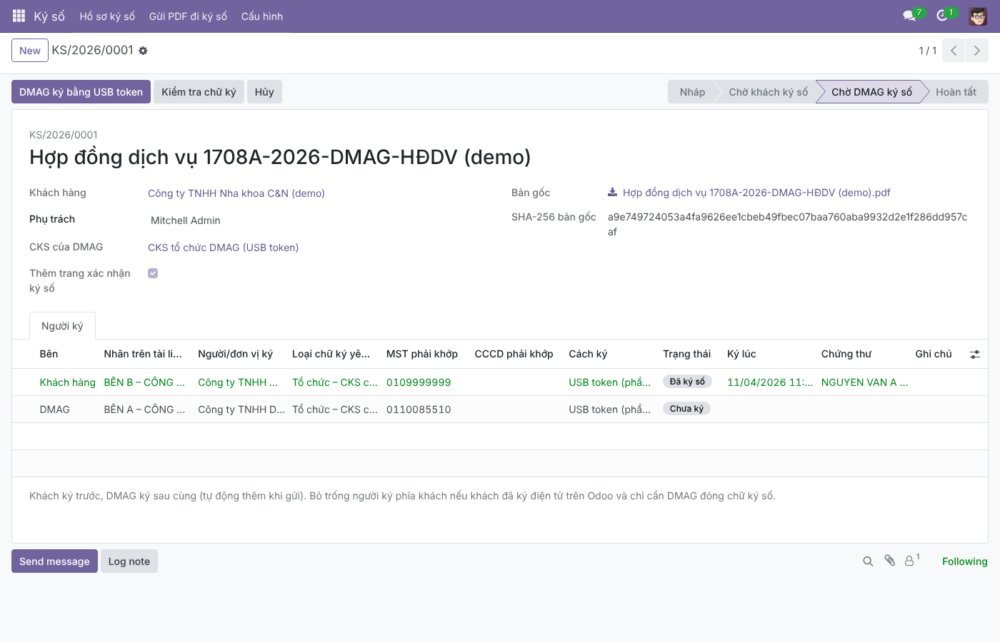 |

| 4. DMAG ký bằng USB token | 5. Hoàn tất | 6. Kiểm tra chữ ký |
|---|---|---|
| 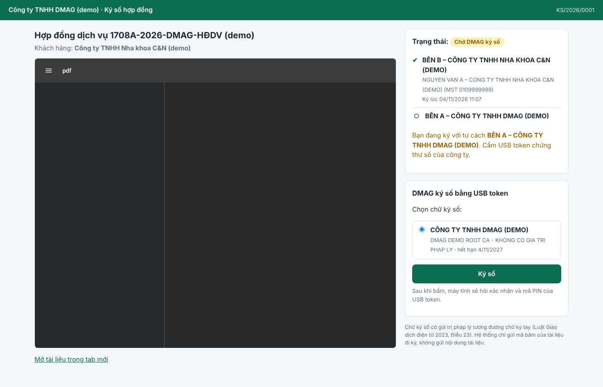 | 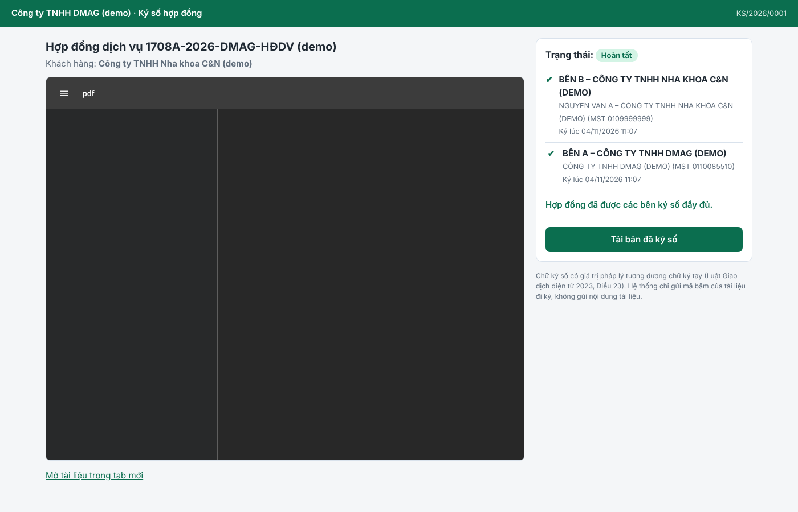 | 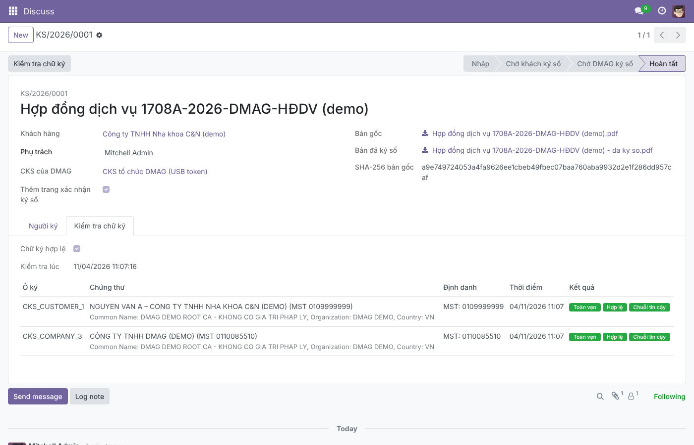 |

| Trang xác nhận ký số trong PDF | Khách ký bằng app (giả lập) | Kết nối module ký | Trên điện thoại |
|---|---|---|---|
| 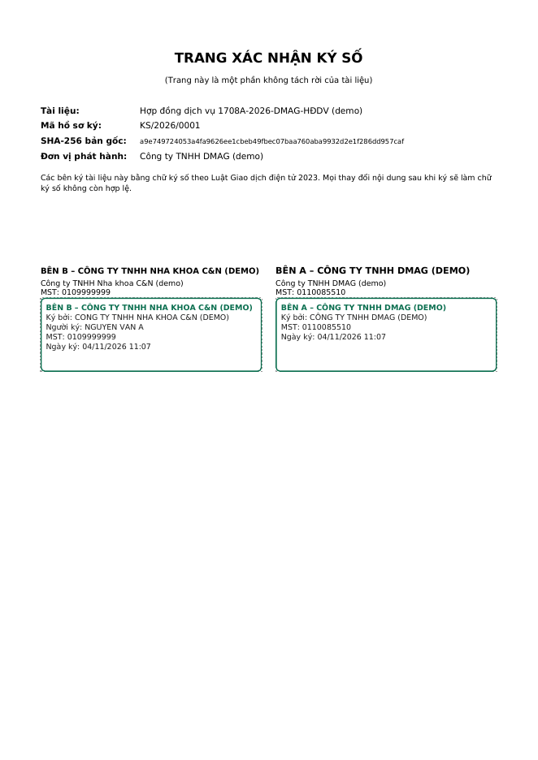 | 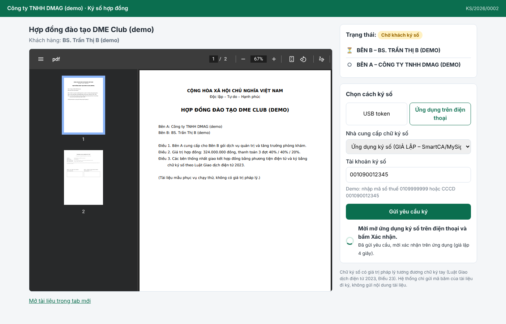 | 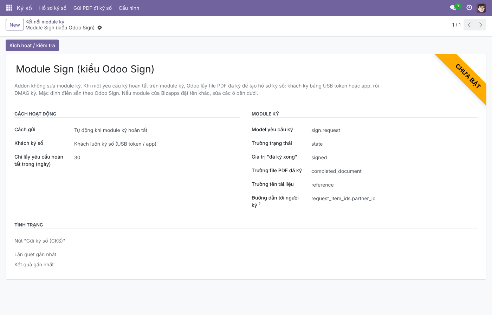 | 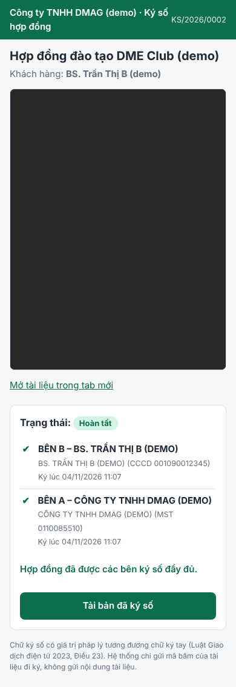 |

## 2. Cài đặt trên máy chủ Odoo 17

1. Cài thư viện Python (đã thử trên image chính thức `odoo:17.0`):
   ```bash
   pip3 install -r requirements.txt
   # pyHanko==0.25.3, pyOpenSSL==24.2.1, urllib3==1.26.20
   ```
   pyHanko cần `cryptography` bản mới. Vì vậy phải nâng `pyOpenSSL` và `urllib3` cùng lúc, nếu không Odoo
   sẽ lỗi khi import `ir_mail_server`. Bộ phiên bản trên đã chạy được với Odoo 17.
2. Chép thư mục `addons/dmag_esign_cks` vào addons path, cập nhật danh sách ứng dụng, cài **"DMAG – Chữ ký số cho hợp đồng"**.
   Addon chỉ phụ thuộc `mail` và `portal`.
3. Chạy test: `odoo -d <db_test> -i dmag_esign_cks --test-enable --test-tags=/dmag_esign_cks --stop-after-init`
   (kết quả lúc phát triển: **37/37 test đạt**, gồm 21 test lõi, 14 test ký số trong Sign và 2 test phần nối "ký xong rồi ký số",
   chạy cùng module Sign giả lập trong `e2e/fake_addons/sign`).
   Lệnh test kèm Sign giả lập: `odoo --addons-path=addons,e2e/fake_addons -i dmag_esign_cks,sign,dmag_esign_cks_sign --test-enable --test-tags=/dmag_esign_cks,/dmag_esign_cks_sign`.

Chạy thử nhanh bằng Docker: `docker compose up -d` rồi mở http://localhost:8069 (admin/admin, DB có dữ liệu demo).

## 3. Cấu hình (menu **Ký số › Cấu hình**)

1. **Nhà cung cấp chữ ký số**
   - **CKS của DMAG:** cài xong đã có sẵn bản ghi **"CKS tổ chức DMAG (USB token)"**, là cách mặc định. Kiểm tra công ty đã nhập **Mã số thuế**, vì Odoo dùng nó để chặn token không phải của DMAG.
     Khi đến lượt, người phụ trách hồ sơ nhận việc cần làm "DMAG ký số bằng USB token". Người đó mở hồ sơ, bấm **DMAG ký bằng USB token**, cắm token và nhập PIN.
     Muốn ký tự động thì tạo bản ghi khác, đánh dấu "Dùng để DMAG ký" và đặt lên đầu danh sách.
     - Loại *Chứng thư trên máy chủ (.p12/.pfx)*: tải file lên và nhập mật khẩu.
     - Loại *VNPT SmartCA / Viettel MySign*: nhập API, Client ID/secret và "Tài khoản ký của DMAG".
     - Có thể nhập *TSA URL* để gắn dấu thời gian.
   - **Cho khách ký từ xa:** bản ghi *VNPT SmartCA* và *Viettel MySign* đã tạo sẵn ở trạng thái lưu trữ. Điền thông tin tài khoản đối tác rồi bật lên.
     Nếu tài liệu API của nhà cung cấp khác mặc định, sửa ở ô *Endpoint tùy chỉnh (JSON)*, không cần sửa code.
   - Bấm **Kiểm tra kết nối / chứng thư** để thử.
2. **Root CA tin cậy:** thêm Root CA quốc gia và CA gốc của các nhà cung cấp (VNPT, Viettel, BKAV, FPT, MISA…).
   Thiếu Root CA thì cột "Chuỗi tin cậy" sẽ báo đỏ dù chữ ký vẫn toàn vẹn.
3. **Khách hàng:** ô *Mã số thuế* có sẵn. Addon thêm **Số CCCD (ký số)** cho cá nhân và **Luôn yêu cầu ký số**.

## 4. Phần mềm "DMAG Ký số" cho USB token

- Mã nguồn ở `agent/` (Go), build bằng `agent/build.sh`. Script tạo `DMAGKySo.exe` và tự chép vào addon,
  để trang ký có link tải.
- Khách **tải về, bấm đúp một lần**: phần mềm tự cài cho người dùng hiện tại (không cần quyền admin) và tự chạy khi bật máy.
- Phần mềm đọc kho chứng thư Windows, nên **dùng được token của mọi nhà cung cấp**, vì driver token khách đã cài để khai thuế đưa chứng thư vào đó.
- **Bảo mật:**
  - Phần mềm chỉ nghe trên `127.0.0.1`.
  - Chỉ trang trong danh sách cho phép mới gọi được. Mặc định gồm `dmagroup.vn` và `localhost:8069`. Gặp tên miền lạ, phần mềm hỏi người dùng.
  - Trước mỗi lần ký, phần mềm hiện hộp thoại xác nhận, sau đó driver token hỏi PIN.
  - Phần mềm chỉ nhận **mã băm**, không nhận nội dung hợp đồng.
- Nếu Odoo chạy ở tên miền khác (ví dụ `erp.dmagroup.vn`), build lại với `ORIGINS=https://erp.dmagroup.vn ./build.sh`, hoặc để khách bấm "Có" lần đầu.
- **Trước khi phát hành:** nên ký số file .exe (Authenticode) để Windows SmartScreen và phần mềm diệt virus không cảnh báo.

## 5. Cách phụ: ký xong trên Sign rồi mới ký số (không cần mã nguồn Sign)

> Chỉ dùng nếu chưa gắn được `dmag_esign_cks_sign`. Không bật cả hai cách cho cùng một yêu cầu ký.


**Không cần sửa module ký và không cần viết module cầu nối.** Vào **Ký số › Cấu hình › Kết nối module ký**, mở bản ghi
"Module Sign (kiểu Odoo Sign)" rồi bấm **Kích hoạt / kiểm tra**.

- Các ô điền sẵn theo Odoo Sign: model `sign.request`, trạng thái `state = signed`, file `completed_document`,
  tên `reference`, người ký `request_item_ids.partner_id`. Bizapps làm "giống Odoo Sign" nên nhiều khả năng giữ
  nguyên các tên này. Nếu khác, chỉ cần sửa các ô tương ứng. Nút Kích hoạt sẽ báo nếu model hoặc trường không tồn tại.
- **Tự động:** cứ 5 phút, yêu cầu ký nào đã hoàn tất trên module Sign sẽ được tạo hồ sơ ký số. Khách nhận email
  mời ký bằng USB token hoặc app, sau đó DMAG ký bằng USB token.
- **Thủ công:** module Sign có thêm nút **Gửi ký số (CKS)** trong menu Thao tác.
- **Khách hàng** là người ký đầu tiên không phải người của công ty mình.
- Ô **"Khách ký số"** chọn một trong ba: luôn ký, theo cài đặt từng khách, hoặc chỉ DMAG ký.
- Ký xong, file PDF đã ký số được gửi ngược vào phần trao đổi (chatter) của chính yêu cầu ký.

Model khác (ví dụ hợp đồng `dmag.contract`) dùng mixin `dmag.cks.mixin` và hàm `_dmag_cks_on_done(envelope)` để
nhận file đã ký và chuyển trạng thái.

## 6. Đã kiểm chứng và chưa kiểm chứng

| Hạng mục | Kết quả |
|---|---|
| Ký PAdES nhiều chữ ký nối tiếp (RSA, ECDSA), chữ ký sai bị từ chối, sửa 1 byte thì mọi chữ ký báo hỏng | ✅ Test tự động |
| Luồng Odoo: khách ký USB, **DMAG ký USB (sai MST bị chặn, link của khách không ký thay DMAG được)**, cá nhân ký vào ô tổ chức bị chặn, ký từ xa (giả lập) có chờ xác nhận, DMAG tự ký bằng .p12 | ✅ 17/17 test Odoo |
| **Ký số trong module Sign** (không cần mã nguồn): khách ký số rồi DMAG vẽ, ngược thứ tự, vẽ trước rồi ký số, hai người cùng lúc (trước và sau khi chốt), sai MST, nhân viên dùng token khách, đúng lượt, vai trò bắt buộc, lỗi từ trình duyệt, tắt thì Sign như cũ, DMAG ký MySign, cấu hình kiểm tra/sai tên | ✅ 14 test + trình duyệt thật (`e2e/sign_flow.js`: khách USB token, DMAG Viettel MySign giả lập). ⏳ Cần chạy trên bản Sign thật của Bizapps |
| Viettel MySign: lấy chứng thư, chờ xác nhận, từ chối, sai mật khẩu, mã hóa tên | ✅ 4 test với máy chủ MySign giả lập. ⏳ Cần tài khoản đối tác Viettel-CA |
| Module dò `dmag_sign_probe` | ✅ 38/38 khớp trên bản Sign giả lập |
| Nối module ký kiểu Odoo Sign (cách phụ): tự tạo hồ sơ, không trùng, không nhận người nội bộ làm khách | ✅ 4 test với module Sign giả lập |
| Trình duyệt thật: khách ký USB, DMAG ký USB, ký từ xa giả lập (`e2e/full_demo.js`) | ✅ Playwright + Chromium |
| PDF kiểm tra bằng công cụ độc lập (poppler `pdfsig`) | ✅ "Signature is Valid" |
| **Phần mềm DMAG Ký số trên Windows với USB token thật** | ⏳ Code đã biên dịch, **chưa chạy trên máy Windows**. Danh sách kiểm thử ở `agent/README.md` |
| **API VNPT SmartCA / Viettel MySign thật** | ⏳ Code theo tài liệu công khai, **cần tài khoản sandbox để đối chiếu** endpoint và tên trường |
| Dấu thời gian (TSA) của CA thật, kiểm tra thu hồi (OCSP/CRL) trực tuyến | ⏳ Có trong code, chưa thử với dịch vụ thật |
| Mở PDF trong Adobe Reader trên Windows | ⏳ Cần cài Root CA Việt Nam vào Adobe để hiện "hợp lệ" |
