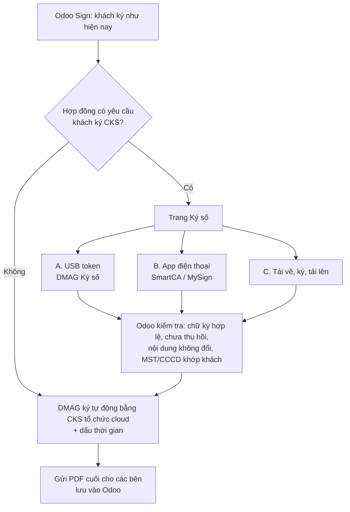

# Phương án chốt (v2): Addon chữ ký số cho Odoo Sign

> **Trạng thái:** Chờ phê duyệt · **Ngày:** 14/10/2026 · Bản này thay phần phương án (mục 4–7) của [bản đề xuất v1](de-xuat-chu-ky-so-odoo-sign.md). Phần căn cứ pháp lý vẫn xem ở v1.
> **Lưu ý:** Đây là phân tích kỹ thuật và pháp lý để định hướng, không thay cho tư vấn của luật sư.

## 0. Những điểm đã chốt

- Chỉ làm **addon tích hợp**, **không sửa và không làm lại Odoo Sign**.
- **Nội bộ** ký bằng Odoo Sign sẵn có, không thêm gì.
- **DMAG** ký bằng **CKS tổ chức dạng cloud**, ký tự động trong Odoo.
- **Khách hàng** là phần còn phải giải quyết. Khách đang dùng đủ loại CKS cloud và USB token của nhiều nhà cung cấp khác nhau.
- Nếu làm thì phải **phủ hết các loại CKS**, và **ký USB token phải dễ cho khách**.

---

## 1. Trả lời từng câu hỏi

### 1.1 "Cá nhân đại diện công ty ký bằng chức năng sẵn của Odoo, mình chỉ cần tích hợp CKS của DMAG là xong, đúng không?"

**Đúng cho phần lớn trường hợp, với 3 điều kiện đi kèm.**

Trước hết cần nói rõ một điểm: chức năng ký sẵn của Odoo (vẽ chữ ký, OTP SMS/email) **không phải là chữ ký số**. Đó là chữ ký điện tử thông thường. Theo Luật Giao dịch điện tử 2023, Điều 23.1, nó vẫn **có giá trị**. Hợp đồng vẫn **ràng buộc công ty khách** nếu người ký đúng là người đại diện theo pháp luật hoặc người được ủy quyền. Chỗ yếu là nó **không mặc nhiên ngang chữ ký tay** (Điều 23.2) và **không thay được dấu** (Điều 23.3).

Ba điều kiện để cách ký này đủ chắc:

1. **DMAG ký CKS tổ chức và gắn dấu thời gian lên bản cuối.** Từ thời điểm đó, nếu ai sửa dù một chữ, chữ ký số sẽ báo không hợp lệ. Vì vậy không bên nào cãi được rằng nội dung đã bị sửa.
2. **Xác định đúng người ký và thẩm quyền.** Hợp đồng ghi rõ "đại diện bởi ông/bà…, chức vụ…, theo điều lệ hoặc giấy ủy quyền số…". OTP gửi về số điện thoại đã đăng ký của người đó. Odoo Sign đã lưu sẵn nhật ký (IP, thời gian, email, SĐT).
3. **Có điều khoản thỏa thuận giao kết điện tử** trong hợp đồng (mẫu ở v1, mục 4.3).

**Khi nào vẫn phải để khách ký CKS?** Khi khách cần bộ hợp đồng "có dấu" để nộp cho cơ quan, ngân hàng, kiểm toán hoặc hồ sơ thầu. Khi hợp đồng giá trị lớn và anh/chị muốn chắc chắn nhất nếu có tranh chấp. Hoặc đơn giản là khi khách tự yêu cầu.

➡️ **Kết luận:** đặt **mặc định là chữ ký Odoo + CKS của DMAG**. Thêm **tùy chọn ký CKS cho khách** với chi phí thấp (mục 2) để không phải từ chối những khách cần.

### 1.2 "Với công ty ký bằng CKS cloud và USB token thì làm thế nào?"

Xem mục 2. Tóm lại, khách chọn 1 trong 3 cách trên cùng một trang ký, và cả 3 cách đều cho ra cùng một loại PDF có chữ ký số chuẩn.

### 1.3 "CKS từ xa của ai tốt thì dùng" (cho DMAG)

| Tiêu chí | Vì sao quan trọng |
|---|---|
| Có **API ký tự động cho tổ chức** (server ký thẳng, không phải bấm xác nhận trên điện thoại cho từng hợp đồng) | Để DMAG ký hàng loạt mà không cần người ngồi bấm |
| Có **dịch vụ dấu thời gian (TSA)** đi kèm | Để chữ ký vẫn kiểm chứng được sau khi chứng thư hết hạn |
| Có tài liệu tích hợp cho đối tác và môi trường **sandbox** | Để viết và test addon trước khi chạy thật |
| Giá theo gói hoặc theo lượt ký phù hợp số lượng hợp đồng | Chi phí vận hành |

**Đề xuất cho DMAG: VNPT SmartCA**, với các lý do sau:
- Anh/chị đang dùng VNPT.
- VNPT có tài liệu tích hợp riêng cho đối tác.
- Dịch vụ chữ ký số của VNPT được Trung tâm Chứng thực điện tử quốc gia (NEAC) đánh giá chất lượng tốt nhất 3 năm liền (2023–2025).
- VNPT có gói ký không giới hạn cho doanh nghiệp.

**Phương án dự phòng: Viettel MySign.** Addon viết theo kiểu adapter, nên nếu đổi nhà cung cấp chỉ cần đổi cấu hình.

---

## 2. Cách phủ hết mọi loại CKS mà không phải tích hợp API từng nhà

Bizapps nói đúng: **nếu tích hợp API riêng của từng nhà cung cấp** (VNPT, Viettel, FPT, MISA, BKAV, CA2, CMC, SDS…) thì rất tốn kém, và không đáng nếu số hợp đồng ít. Cách giải quyết là dùng **hai cơ chế dùng chung cho mọi nhà cung cấp**, và chỉ tích hợp API riêng cho vài nhà phổ biến nhất.

Khi hợp đồng yêu cầu khách ký CKS, khách ký trên Odoo Sign như bình thường, rồi được chuyển ngay sang **trang "Ký số"** với 3 lựa chọn:

### Cách A: Ký bằng USB token (mọi nhà cung cấp) qua phần mềm "DMAG Ký số"

**Vì sao một phần mềm dùng được cho mọi loại token?** Khi khách cài driver token để khai thuế (việc gần như phòng khám nào cũng đã làm), chứng thư số trong token đã được đưa vào **kho chứng thư của Windows**. Phần mềm "DMAG Ký số" chỉ cần đọc kho này. Nó không quan tâm token là của VNPT, Viettel hay BKAV.

**Trải nghiệm của khách:**
1. **Lần đầu tiên:** trang ký hiện nút "Tải DMAG Ký số". Khách cài một lần, mất khoảng 1 phút, giống cài một phần mềm bình thường.
2. **Từ lần sau:** cắm token, bấm **"Ký bằng USB token"**, chọn tên mình trong danh sách, nhập mã PIN là xong. Trình duyệt có thể hỏi "Cho phép truy cập thiết bị trên máy này?" một lần duy nhất.
3. Khách **không phải** chỉnh cấu hình trình duyệt (chrome://flags) như một số plugin cũ của các nhà cung cấp.

Phần mềm này chỉ nhận **mã hash** của tài liệu, ký bằng token, rồi trả kết quả về Odoo. Nội dung hợp đồng không đi qua phần mềm.

### Cách B: Ký bằng app trên điện thoại (CKS cloud), tích hợp trực tiếp các nhà phổ biến

- Khách chọn nhà cung cấp, ví dụ VNPT SmartCA hoặc Viettel MySign, rồi nhập số CCCD hoặc mã số thuế. App trên điện thoại hiện thông báo, khách bấm **Xác nhận** là xong.
- **Làm trước:** VNPT SmartCA và Viettel MySign. **Làm sau, theo nhu cầu thực tế:** FPT, MISA, BKAV, CA2, CMC, SDS…
- Mỗi nhà là một adapter riêng. Phần tốn kém **không nằm ở code** (vài ngày cho mỗi nhà khi đã có sandbox) mà ở **thủ tục ký hợp tác và cấp tài khoản API** với từng nhà. Vì vậy chỉ làm khi có đủ khách dùng nhà đó.

### Cách C: Tải về, ký bằng công cụ của mình, rồi tải lên (dự phòng cho 100% trường hợp)

- Khách tải PDF về, ký bằng bất kỳ công cụ nào họ đang có:
  - Foxit hoặc Adobe Reader kèm USB token.
  - Phần mềm ký của nhà cung cấp.
  - App hoặc trang web của nhà cung cấp CKS cloud.
- Sau đó khách tải file đã ký lên lại **ngay trên link ký của Odoo**.
- **Odoo tự kiểm tra** rồi mới chấp nhận:
  1. Chữ ký số hợp lệ và chứng thư được cấp bởi CA có phép tại Việt Nam.
  2. Chứng thư chưa bị thu hồi.
  3. **Nội dung hợp đồng giống hệt bản DMAG gửi**, chỉ có thêm chữ ký.
  4. **Mã số thuế hoặc CCCD trong chứng thư khớp với khách hàng trong Odoo.** Đây là điểm quan trọng: nó chứng minh đúng công ty đó đã ký.
- Cách này **không cần tích hợp với nhà cung cấp nào**, nên chi phí gần như bằng 0. Nó bao trọn cả những nhà cung cấp chưa làm Cách B.

> 💡 **Khách là cá nhân chưa có CKS:** từ năm 2025, ứng dụng **VNeID** cho phép đăng ký chứng thư chữ ký số cá nhân miễn phí 12 tháng, với khoảng 8 nhà cung cấp tham gia. Ngoài ra, Nghị quyết 66.22/2026/NQ-CP có nội dung miễn phí cho cá nhân, chủ yếu phục vụ dịch vụ công. Cần kiểm tra thêm phạm vi dùng loại chứng thư miễn phí này cho hợp đồng thương mại trước khi khuyến nghị cho khách.

### Tổng hợp: một trang ký, phủ hết các loại CKS

| Khách đang có | Cách ký | Chi phí tích hợp |
|---|---|---|
| Không có CKS (đa số khách cá nhân) | Odoo Sign sẵn có, sau đó DMAG ký CKS | 0 (chỉ cần tích hợp CKS của DMAG) |
| USB token của **bất kỳ** nhà nào | **A**: DMAG Ký số, hoặc **C**: Foxit/Adobe rồi tải lên | Làm 1 lần, dùng cho mọi nhà |
| CKS cloud VNPT / Viettel | **B**: xác nhận trên app | Theo từng nhà |
| CKS cloud của nhà khác | **C**: ký bằng app/web của nhà đó rồi tải lên. Nếu nhiều khách dùng thì nâng lên **B** | 0, nâng cấp khi cần |

---

## 3. Luồng hoạt động

**Về kỹ thuật:**
- Addon kế thừa `sign.request` và `sign.item.role` của Odoo Sign, thêm trường "Yêu cầu khách ký số" và các trạng thái "Chờ khách ký số", "Chờ DMAG ký số", "Hoàn tất ký số".
- Phần ký và kiểm tra PDF dùng thư viện **pyHanko**, theo chuẩn PAdES với dấu thời gian và dữ liệu thu hồi nhúng sẵn. Odoo Sign được để nguyên.

---

## 4. Lộ trình

| Giai đoạn | Nội dung | Ước lượng* |
|---|---|---|
| **1** | Khung addon. **DMAG ký tự động** bằng CKS cloud + dấu thời gian. **Cách C** (tải lên và tự kiểm tra). Nút "Kiểm tra chữ ký" trong Odoo. | 3–4 tuần |
| **2** | **Cách A**: phần mềm "DMAG Ký số" cho Windows (bộ cài một lần, dùng mọi token). | 2–3 tuần |
| **3** | **Cách B**: adapter VNPT SmartCA và Viettel MySign. Các nhà khác làm theo nhu cầu. | 3–5 ngày mỗi nhà, sau khi có sandbox |

\* Thời gian code. Thủ tục với nhà cung cấp CA chạy song song.

**Ngay sau giai đoạn 1** anh/chị đã ký pháp lý được cho **mọi khách**: khách không có CKS ký bằng Odoo, khách có CKS thì dùng Cách C. Giai đoạn 2 và 3 chỉ làm cho khách **tiện hơn**.

---

## 5. Cần anh/chị duyệt và cung cấp

- [ ] Duyệt mô hình: **mặc định chữ ký Odoo + CKS DMAG**; khách cần thì ký CKS bằng Cách A/B/C.
- [ ] Duyệt nhà cung cấp CKS cloud cho DMAG: **VNPT SmartCA** (dự phòng: Viettel MySign).
- [ ] Duyệt lộ trình 3 giai đoạn; cho phép bắt đầu code giai đoạn 1 trong repo này.
- [ ] **Hỏi Bizapps:** (1) server có cài được thư viện Python **pyHanko** không; (2) quy trình deploy addon tự viết lên Odoo của mình.
- [ ] **Liên hệ VNPT:** mua chứng thư số tổ chức loại ký từ xa có API ký tự động, và xin tài khoản sandbox tích hợp.

## Nguồn bổ sung (ngoài các nguồn ở v1)

- VNPT được NEAC đánh giá chất lượng tốt nhất 2023–2025: [vneconomy.vn](https://vneconomy.vn/vnpt-smartca-duoc-gia-han-chung-thu-so-den-2031-cung-co-niem-tin-khach-hang-so.htm)
- Viettel MySign được cấp phép ký số từ xa: [vov.vn](https://vov.vn/doanh-nghiep/doanh-nghiep-24h/dich-vu-chu-ky-so-tu-xa-mysign-cua-viettel-chinh-thuc-duoc-cap-phep-post960623.vov)
- Chữ ký số cá nhân trên VNeID: [luatvietnam.vn: Nghị quyết 66.22/2026/NQ-CP](https://luatvietnam.vn/tin-van-ban-moi/vneid-mien-phi-dich-vu-chung-thuc-chu-ky-so-cong-cong-cho-ca-nhan-186-110393-article.html) · [thuvienphapluat.vn](https://thuvienphapluat.vn/hoi-dap-phap-luat/toan-dan-duoc-cung-cap-chu-ky-so-mien-phi-tren-ung-dung-vneid-tu-nam-2026-dung-khong-138082280.html) · [ketoananpha.vn](https://ketoananpha.vn/cach-dang-ky-chu-ky-so-vneid.html)
- Ký PDF bằng USB token trên Foxit/Adobe: [fastca.vn](https://fastca.vn/cach-ky-chu-ky-so-file-pdf-foxit-reader-adobe-reader)
- Plugin ký số cũ phải mở chrome://flags: [hướng dẫn của tỉnh Bình Phước (PDF)](https://binhphuoc.gov.vn/uploads/binhphuoc/cks/2019_04/huongdankyso_onewin-sys.pdf)
