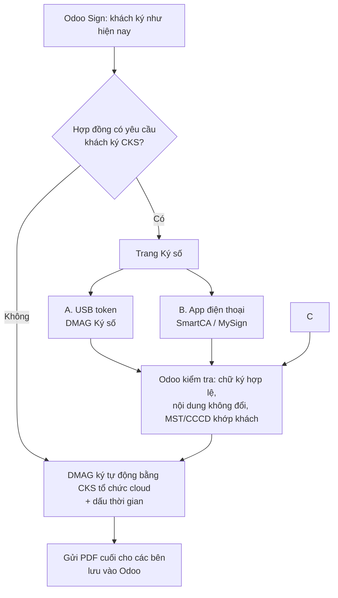

# Phương án chốt (v2): Addon chữ ký số cho module ký trên Odoo

> **Trạng thái:** Đã duyệt, đã làm bản chạy thử (xem [hướng dẫn triển khai](huong-dan-trien-khai.md)) · **Ngày:** 14/10/2026 · Bản này thay phần phương án (mục 4–7) của [bản đề xuất v1](de-xuat-chu-ky-so-odoo-sign.md). Phần căn cứ pháp lý vẫn xem ở v1.
> **Lưu ý:** Đây là phân tích kỹ thuật và pháp lý để định hướng, không thay cho tư vấn của luật sư.

## 0. Những điểm đã chốt

- Chỉ làm **addon tích hợp**, **không sửa và không làm lại module ký** (bản Sign do Bizapps tùy biến trên Odoo 17 CE).
- **Nội bộ** ký bằng module ký sẵn có, không thêm gì.
- **DMAG** ký bằng **CKS tổ chức dạng cloud**, ký tự động trong Odoo.
- **Khách hàng** là phần còn phải giải quyết. Khách đang dùng đủ loại CKS cloud và USB token của nhiều nhà cung cấp khác nhau.
- Nếu làm thì phải **phủ hết các loại CKS**, và **ký USB token phải dễ cho khách**.
- **Bỏ cách "tải về, ký, tải lên".** Khách phải ký nhanh, trực tuyến (USB token hoặc app).

## 0.1 Bối cảnh hệ thống hiện tại (rút từ các phiên làm việc trước với Claude Code)

- **Odoo 17 Community** do Bizapps triển khai, chạy trên máy chủ riêng (dmagroup.vn). Bizapps cài được module tự viết.
- **Module ký đang dùng:** bản Sign do **Bizapps tùy biến trên Odoo 17 CE**. Odoo Sign gốc là app Enterprise, bản Community không có. Addon CKS chạy độc lập và nối vào module của Bizapps qua một module cầu nối nhỏ (mẫu code ở [hướng dẫn triển khai, mục 5](huong-dan-trien-khai.md#5-nối-với-module-ký-của-bizapps-việc-còn-lại-cho-bizapps)).
- **Đã có sẵn code ký số:** module `dmag_esign_mysign` (Odoo 17, nằm trong repo ERP-module-nha-khoa) đã có khung ký số dùng chung gồm `dmag.esign.request`, `dmag.esign.mixin` và `dmag.esign.provider`, kèm adapter **Viettel MySign**. Còn thiếu phần nhúng chữ ký vào PDF theo chuẩn PAdES. Adapter MySign trong addon mới được chuyển từ module này sang. Addon mới bổ sung phần nhúng PAdES còn thiếu, và là khung dùng chung, không gắn với phòng khám.
- **Module hợp đồng `dmag_contract`** (repo CRM-odoo) hiện xác nhận "đã ký" bằng nút bấm tay và tải file lên tay. Sau khi có addon, hợp đồng sẽ **tự chuyển sang trạng thái "đã ký"** và tự gắn file PDF đã ký số khi các bên ký xong.
- **Viettel** đang cung cấp hóa đơn điện tử cho DMAG, và Giám đốc đã có tài khoản MySign.

---

## 1. Trả lời từng câu hỏi

### 1.1 "Cá nhân đại diện công ty ký bằng chức năng sẵn của Odoo, mình chỉ cần tích hợp CKS của DMAG là xong, đúng không?"

**Đúng cho phần lớn trường hợp, với 3 điều kiện đi kèm.**

Trước hết cần nói rõ một điểm: chức năng ký sẵn của Odoo (vẽ chữ ký, OTP SMS/email) **không phải là chữ ký số**. Đó là chữ ký điện tử thông thường. Theo Luật Giao dịch điện tử 2023, Điều 23.1, nó vẫn **có giá trị**. Hợp đồng vẫn **ràng buộc công ty khách** nếu người ký đúng là người đại diện theo pháp luật hoặc người được ủy quyền. Chỗ yếu là nó **không mặc nhiên ngang chữ ký tay** (Điều 23.2) và **không thay được dấu** (Điều 23.3).

Ba điều kiện để cách ký này đủ chắc:

1. **DMAG ký CKS tổ chức và gắn dấu thời gian lên bản cuối.** Từ thời điểm đó, nếu ai sửa dù một chữ, chữ ký số sẽ báo không hợp lệ. Vì vậy không bên nào cãi được rằng nội dung đã bị sửa.
2. **Xác định đúng người ký và thẩm quyền.** Hợp đồng ghi rõ "đại diện bởi ông/bà…, chức vụ…, theo điều lệ hoặc giấy ủy quyền số…". OTP gửi về số điện thoại đã đăng ký của người đó. Odoo Sign đã lưu sẵn nhật ký (IP, thời gian, email, SĐT).
3. **Có điều khoản thỏa thuận giao kết điện tử** trong hợp đồng (mẫu ở v1, mục 4.3).

**Khi nào vẫn phải để khách ký CKS?** Khi khách cần bộ hợp đồng "có dấu" để nộp cho cơ quan, ngân hàng, kiểm toán hoặc hồ sơ thầu. Khi hợp đồng giá trị lớn và anh/chị muốn chắc chắn nhất nếu có tranh chấp. Hoặc đơn giản là khi khách tự yêu cầu.

➡️ **Kết luận:** đặt **mặc định là chữ ký Odoo + CKS của DMAG**. Thêm **tùy chọn ký CKS cho khách** với chi phí thấp (mục 2) để không phải từ chối những khách cần.

### 1.2 "Với công ty ký bằng CKS cloud và USB token thì làm thế nào?"

Xem mục 2. Tóm lại, khách chọn 1 trong 3 cách trên cùng một trang ký, và cả 3 cách đều cho ra cùng một loại PDF có chữ ký số chuẩn.

### 1.3 "CKS từ xa của ai tốt thì dùng" (cho DMAG)

| Tiêu chí | Vì sao quan trọng |
|---|---|
| Có **API ký tự động cho tổ chức** (server ký thẳng, không phải bấm xác nhận trên điện thoại cho từng hợp đồng) | Để DMAG ký hàng loạt mà không cần người ngồi bấm |
| Có **dịch vụ dấu thời gian (TSA)** đi kèm | Để chữ ký vẫn kiểm chứng được sau khi chứng thư hết hạn |
| Có tài liệu tích hợp cho đối tác và môi trường **sandbox** | Để viết và test addon trước khi chạy thật |
| Giá theo gói hoặc theo lượt ký phù hợp số lượng hợp đồng | Chi phí vận hành |

**Đề xuất cho DMAG: Viettel MySign**, với các lý do sau:
- Đã có sẵn code adapter MySign (`dmag_esign_mysign`).
- Giám đốc đã có tài khoản MySign.
- Viettel đang cung cấp hóa đơn điện tử cho DMAG, nên gom về một nhà cung cấp.
- MySign đã được tích hợp vào hơn 965 hệ thống và vào VNeID.

**Phương án dự phòng: VNPT SmartCA.** Dịch vụ chữ ký số của VNPT được Trung tâm Chứng thực điện tử quốc gia (NEAC) đánh giá chất lượng tốt nhất 3 năm liền (2023–2025), và VNPT có tài liệu tích hợp cho đối tác.

Trước khi chốt, cần hỏi cả hai nhà 2 câu: có **API ký tự động cho chứng thư tổ chức** không, và **giá theo lượt ký hoặc theo gói** là bao nhiêu. Nhà nào đáp ứng tốt hơn thì chọn. Addon viết theo kiểu adapter, nên đổi nhà cung cấp chỉ cần đổi cấu hình.

---

## 2. Cách phủ các loại CKS của khách

Bizapps nói đúng: **nếu tích hợp API riêng của từng nhà cung cấp** (VNPT, Viettel, FPT, MISA, BKAV, CA2, CMC, SDS…) thì rất tốn kém, và không đáng nếu số hợp đồng ít. Cách giải quyết:
- **USB token:** một phần mềm dùng chung cho **mọi** nhà cung cấp.
- **CKS cloud:** chỉ tích hợp API cho vài nhà phổ biến nhất trước, thêm nhà khác khi có khách dùng.

Khi hợp đồng yêu cầu khách ký CKS, khách ký trên module ký như bình thường, rồi nhận link **trang "Ký số"** với 2 lựa chọn:

### Cách A: Ký bằng USB token (mọi nhà cung cấp) qua phần mềm "DMAG Ký số"

**Vì sao một phần mềm dùng được cho mọi loại token?** Khi khách cài driver token để khai thuế (việc gần như phòng khám nào cũng đã làm), chứng thư số trong token đã được đưa vào **kho chứng thư của Windows**. Phần mềm "DMAG Ký số" chỉ cần đọc kho này. Nó không quan tâm token là của VNPT, Viettel hay BKAV.

**Trải nghiệm của khách:**
1. **Lần đầu tiên:** trang ký hiện nút "Tải DMAG Ký số". Khách cài một lần, mất khoảng 1 phút, giống cài một phần mềm bình thường.
2. **Từ lần sau:** cắm token, bấm **"Ký bằng USB token"**, chọn tên mình trong danh sách, nhập mã PIN là xong. Trình duyệt có thể hỏi "Cho phép truy cập thiết bị trên máy này?" một lần duy nhất.
3. Khách **không phải** chỉnh cấu hình trình duyệt (chrome://flags) như một số plugin cũ của các nhà cung cấp.

Phần mềm này chỉ nhận **mã hash** của tài liệu, ký bằng token, rồi trả kết quả về Odoo. Nội dung hợp đồng không đi qua phần mềm.

### Cách B: Ký bằng app trên điện thoại (CKS cloud), tích hợp trực tiếp các nhà phổ biến

- Khách chọn nhà cung cấp, ví dụ VNPT SmartCA hoặc Viettel MySign, rồi nhập số CCCD hoặc mã số thuế. App trên điện thoại hiện thông báo, khách bấm **Xác nhận** là xong.
- **Làm trước:** VNPT SmartCA và Viettel MySign. **Làm sau, theo nhu cầu thực tế:** FPT, MISA, BKAV, CA2, CMC, SDS…
- Mỗi nhà là một adapter riêng. Phần tốn kém **không nằm ở code** (vài ngày cho mỗi nhà khi đã có sandbox) mà ở **thủ tục ký hợp tác và cấp tài khoản API** với từng nhà. Vì vậy chỉ làm khi có đủ khách dùng nhà đó.

> Cách C (tải về, ký bằng công cụ riêng, rồi tải lên) đã được **bỏ** theo yêu cầu: khách chỉ ký trực tuyến bằng cách A hoặc B.

### Tổng hợp: một trang ký, phủ hết các loại CKS

| Khách đang có | Cách ký | Chi phí tích hợp |
|---|---|---|
| Không có CKS (đa số khách cá nhân) | Odoo Sign sẵn có, sau đó DMAG ký CKS | 0 (chỉ cần tích hợp CKS của DMAG) |
| USB token của **bất kỳ** nhà nào | **A**: DMAG Ký số | Làm 1 lần, dùng cho mọi nhà |
| CKS cloud VNPT / Viettel | **B**: xác nhận trên app | Theo từng nhà |
| CKS cloud của nhà khác (FPT, MISA, BKAV, CA2…) | **B**: thêm adapter cho nhà đó. Trong lúc chờ, khách dùng USB token (A) nếu có | Vài ngày code/nhà, sau khi có tài liệu API + tài khoản đối tác |

---

## 3. Luồng hoạt động

**Về kỹ thuật:**
- Addon kế thừa model yêu cầu ký của module ký đang dùng (`sign.request` nếu là Odoo Sign, `sign.oca.request` nếu là `sign_oca`), thêm trường "Yêu cầu khách ký số" và các trạng thái "Chờ khách ký số", "Chờ DMAG ký số", "Hoàn tất ký số".
- Phần ký và kiểm tra PDF dùng thư viện **pyHanko**, theo chuẩn PAdES với dấu thời gian và dữ liệu thu hồi nhúng sẵn. Module ký gốc được để nguyên.

---

## 4. Lộ trình và tiến độ

| Giai đoạn | Nội dung | Tiến độ |
|---|---|---|
| **1** | Addon `dmag_esign_cks`: hồ sơ ký số, trang ký của khách, DMAG ký tự động, dấu thời gian, kiểm tra chữ ký, trang xác nhận ký số | ✅ Xong bản chạy thử, 14/14 test Odoo + thử trên trình duyệt |
| **2** | **Cách A**: phần mềm "DMAG Ký số" cho Windows (mọi token) | ✅ Code xong, test trên Linux. ⏳ **Cần thử trên Windows với token thật** |
| **3** | **Cách B**: adapter VNPT SmartCA, Viettel MySign | ✅ Khung + adapter theo tài liệu công khai. ⏳ **Cần tài khoản sandbox để đối chiếu** |
| **4** | Cầu nối với module ký của Bizapps và `dmag_contract` | ⏳ Cần mã nguồn / tên model của Bizapps (mẫu code đã có) |
| **5** | Thêm nhà cung cấp cloud khác (FPT, MISA, BKAV, CA2…) | Theo nhu cầu, khi có tài liệu API |

## 5. Việc cần anh/chị và Bizapps làm tiếp

- [ ] **Chọn nhà cung cấp CKS cloud cho DMAG** (đề xuất Viettel MySign, dự phòng VNPT SmartCA). Hỏi về API ký tự động cho chứng thư tổ chức, giá, và **tài khoản sandbox**.
- [ ] **Đăng ký làm đối tác tích hợp** với VNPT SmartCA và Viettel MySign, để khách dùng 2 app này ký được trên trang của DMAG.
- [ ] **Thử phần mềm DMAG Ký số trên 1–2 máy Windows** có USB token thật (VNPT, Viettel, BKAV…) theo checklist trong `agent/README.md`.
- [ ] **Bizapps:** cài thư viện trong `requirements.txt`, cài addon, gửi tên model và hàm "hoàn tất ký" của module Sign để viết cầu nối.
- [ ] **Ký số file DMAGKySo.exe** (chứng thư ký code) trước khi phát cho khách.
- [ ] Nhập **Root CA quốc gia và CA gốc của các nhà cung cấp** vào menu Root CA tin cậy.

## Nguồn bổ sung (ngoài các nguồn ở v1)

- VNPT được NEAC đánh giá chất lượng tốt nhất 2023–2025: [vneconomy.vn](https://vneconomy.vn/vnpt-smartca-duoc-gia-han-chung-thu-so-den-2031-cung-co-niem-tin-khach-hang-so.htm)
- Viettel MySign được cấp phép ký số từ xa: [vov.vn](https://vov.vn/doanh-nghiep/doanh-nghiep-24h/dich-vu-chu-ky-so-tu-xa-mysign-cua-viettel-chinh-thuc-duoc-cap-phep-post960623.vov)
- Chữ ký số cá nhân trên VNeID: [luatvietnam.vn: Nghị quyết 66.22/2026/NQ-CP](https://luatvietnam.vn/tin-van-ban-moi/vneid-mien-phi-dich-vu-chung-thuc-chu-ky-so-cong-cong-cho-ca-nhan-186-110393-article.html) · [thuvienphapluat.vn](https://thuvienphapluat.vn/hoi-dap-phap-luat/toan-dan-duoc-cung-cap-chu-ky-so-mien-phi-tren-ung-dung-vneid-tu-nam-2026-dung-khong-138082280.html) · [ketoananpha.vn](https://ketoananpha.vn/cach-dang-ky-chu-ky-so-vneid.html)
- Ký PDF bằng USB token trên Foxit/Adobe: [fastca.vn](https://fastca.vn/cach-ky-chu-ky-so-file-pdf-foxit-reader-adobe-reader)
- Plugin ký số cũ phải mở chrome://flags: [hướng dẫn của tỉnh Bình Phước (PDF)](https://binhphuoc.gov.vn/uploads/binhphuoc/cks/2019_04/huongdankyso_onewin-sys.pdf)
